# 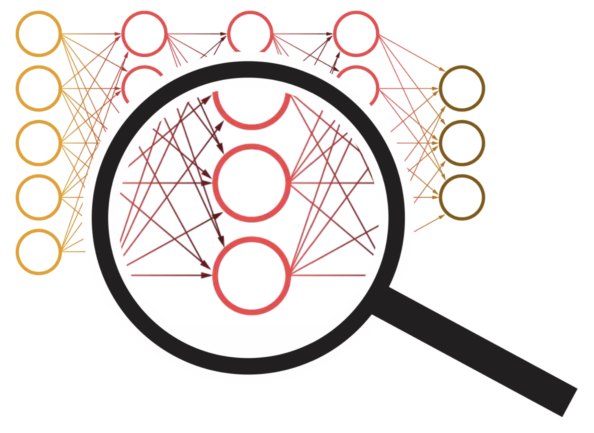 TorchLens

[](https://pypi.org/project/torchlens/)
[](https://pypi.org/project/torchlens/)
[](https://pytorch.org/)
[](https://github.com/johnmarktaylor91/torchlens/actions/workflows/nightly.yml)
[](https://www.apache.org/licenses/LICENSE-2.0)

**Inspect, visualize and intervene on any operation in any neural network.**

<p align="center"><a href="#install">Install</a> · <a href="#learning-torchlens">Tutorials</a> · <a href="#visualization-examples">Visualizations</a> · <a href="https://modelmenagerie.ai">Model&nbsp;Menagerie</a> · <a href="#citing-torchlens">Cite</a></p>

<p align="center">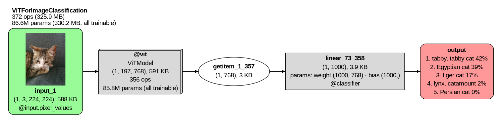</p>

```python
vit = ViTForImageClassification.from_pretrained("google/vit-base-patch16-224").eval()
cat = tl.trace(vit, "cat.jpg")
cat["vit.layers.5.attention"].facets.pattern.shape  # torch.Size([1, 12, 197, 197])
cat.draw(direction="leftright", depth=1)
# ablate one attention head: tabby becomes Egyptian cat
ablated = cat.fork().do(tl.module("vit.layers.5.attention") & tl.head(3), tl.zero_ablate())
ablated.output_table(k=3)
#   rank             label   prob
#      1      Egyptian cat  0.489
#      2  tabby, tabby cat  0.341
#      3         tiger cat  0.147
```

## Why?

Understanding and controlling the computations inside neural networks is [the most important scientific challenge of our time](https://darioamodei.com/post/the-urgency-of-interpretability) (at least). Progress on this problem, known as *mechanistic interpretability*, would [make AI more beneficial for society](https://www.goodfire.com/research/interpretability-for-alzheimers-detection), [illuminate how our brains work](https://doi.org/10.1146/annurev-vision-082114-035447), and guard against undesirable behaviors like [deception](https://arxiv.org/abs/2412.14093) or [killing us all](https://ai-2027.com/).

Some aspects of mechanistic interpretability are deep and open-ended. We need to understand dauntingly complex systems that may soon outsmart us, with new frontier models arriving faster than we can study the current ones. It's not even clear what a "solution" would look like, or how many obstacles remain. We'll surely need help from the AI agents themselves.

Other aspects are just plumbing, and while tedious, they are finite: the same small set of tasks for every model, like extracting and editing its activations and gradients. For instance, PyTorch has long lacked a built-in way to extract every intermediate activation from arbitrary networks (an official docstring admits this can take ["some massaging"](https://github.com/pytorch/vision/blob/e334535aaf10e3327b618e1f9f069e09d18ebb8e/torchvision/models/feature_extraction.py#L391-L405)). But all networks are built from the same basic parts, so a few well-made tools should work on all of them.

The modest goal of TorchLens is to fix these plumbing problems once and for all, so you and your agents can spend your time and tokens on the deep questions, and maybe even solve some of them.

## What TorchLens does

Almost everything you do in TorchLens starts with one function, `tl.trace`. You don't have to set anything up. Pass it any PyTorch model and its input exactly as they are, with no hooks, wrappers or changes to your code:

```python
import torchlens as tl
from transformers import GPT2LMHeadModel

gpt2 = GPT2LMHeadModel.from_pretrained("gpt2").eval()
text = "The capital of France is"

trace = tl.trace(gpt2, text)                  # run model as-is, logging every operation
op = trace["tanh_6"]                          # fetch the 6th tanh operation
op.out.shape                                  # torch.Size([1, 5, 3072])
op.parents, op.children                       # the operations before and after tanh_6
mlp = trace["transformer.h.5.mlp"]            # look up a module's record by its address
mlp.total_flops_forward                       # MLP's forward FLOPs (one of 800+ metadata fields in TorchLens)
trace.draw(module="transformer.h.5.mlp.act")  # draw the graph of the MLP's GELU activation module
```

<picture>
  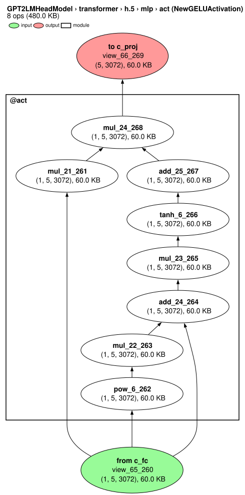
</picture>

This figure zooms in on the MLP's GELU module; here is [the whole GPT-2 graph](https://modelmenagerie.ai/models/gpt2-huggingface/). Each node is one tensor operation. For instance, `tanh_6_270` is the 6th `tanh` operation and the 270th operation overall. The function name and call number are enough on their own, so `trace["tanh_6"]` and `trace["tanh_6_270"]` return the same operation. A trace can also be indexed by a module's address (`trace["transformer.h.5.mlp"]`) or by a selector (below).

That one `tl.trace` call runs your model as usual and logs the result of every operation it executes, not just module outputs. Because the `Trace` object returned by this function holds every step of the forward pass, it can answer questions that require the whole computational graph: which units influence which other units (receptive and projective fields), whether replaying each step reproduces its saved result (`tl.validate`), or how results change downstream when you edit one activation. A trace with gaps (e.g., module outputs only) cannot fully answer such questions.

Since the trace holds everything, TorchLens doesn't need a separate tool for every question. A small "basis set" of composable tools covers just about anything you'd want to do when inspecting or intervening on a network:

**Select** activations or gradients by any criteria, from simple ("every LayerNorm in the `transformer.h.5` module") to sophisticated ("every unit in `layer1` and `layer2` of a ResNet affected by a specific set of units in `conv1`"). Any set of units you can describe by their kind, location and causal links to other units can be picked out with a single selector like those below ([this can be proven](docs/reference/selection_completeness.md)).

```python
trace[tl.func("layer_norm") & tl.in_module("transformer.h.5")]          # by function and module
trace["conv1"].projective_field.of(units, within=["layer1", "layer2"])  # by downstream influence (ResNet-18)
```

**Extract** activations at whatever speed or level of detail you need: save them all, stop the forward pass once you have the ones you want, or quickly run a dynamic model many times while saving only those matching your criteria (e.g., every ReLU after a convolution). The first trace, which records the whole graph, is the slow part: from about twice a plain forward pass on GPT-2 to tens of times on small models. Faster options reuse that graph or skip it ([capture speed](docs/benchmarks/capture.md)):

- `trace.run` captures new inputs at a few times the cost of a forward pass, reusing the graph recorded by the initial call to `tl.trace`.
- Use `tl.record` when the graph can change from one forward to the next (such as an `if` on the input, a mixture of experts sending each token to different experts, or an early exit; [worked example](notebooks/learn/11_dynamic_graphs.ipynb)): it decides what to keep op by op as the model runs, with no graph to build, so it follows whatever path the model takes at a fraction of a trace's cost.
- `tl.extract` returns the output of a few modules by name at about the cost of a plain forward pass, like PyTorch's forward hooks but without writing them.
- Stopping early can beat a plain forward.

```python
trace = trace.run(gpt2, new_text)                            # new input, same graph as the first trace
recording = tl.record(moe, tokens,                           # different inputs reach different experts: no fixed graph
    save=lambda op: op.func_name == "silu" and "experts" in op.address)  # give a rule that runs on every op, keeps the experts that fired
fired = {r.ctx.address for r in recording}                   # which experts ran for this input
# e.g. {'layers.3.experts.1', 'layers.3.experts.6'}; another input gives another set
outs = tl.extract(gpt2, text, ["transformer.h.5"])           # named module outputs, one plain forward with a hook
```

Saved activations can stay connected to the network if you want, so you can train it on any loss computed from them. You can also apply a function to each activation as it is saved (e.g., averaging across token positions or moving it to the CPU), and even go below Python function calls to the results of PyTorch's low-level ATen operations.

```python
trace = tl.trace(
    gpt2, text,
    save=tl.func("tanh"),                          # keep only the tanh ops
    stop_after="transformer.h.5",                  # stop forward pass after block 5
    capture=tl.options.CaptureOptions(
        aten_ops="values",                         # save ATen results too
        activation_transform=lambda x: x.mean(1),  # also save each activation averaged across token positions
    ),
)
trace["tanh_6"].out.norm().backward()              # train on any function of saved activations
trace["tanh_6"].payload.transformed_out            # the saved average across token positions, shape (1, 3072)
trace["tanh_6"].aten_ops[0].out                    # output of the first ATen call beneath tanh_6
```

Gradients work the same way: ask for them when you call `tl.trace`, run a backward pass from any loss you want, and read the gradient at any operation, or at the `grad_fn` nodes PyTorch runs between operations.

```python
trace = tl.trace(
    gpt2, text,
    capture=tl.options.CaptureOptions(save_grads=True),         # record gradients when a backward pass runs
)
loss = trace["lm_head"].out[0, -1].max()                        # any scalar can serve as the loss; here, the top next-word score
trace.backward(loss)                                            # run the backward pass from the loss
trace["tanh_6"].grad.shape                                      # torch.Size([1, 5, 3072]): the gradient at tanh_6's output
trace["tanh_6"].autograd.grad_fn.calls[0].grad_inputs[0].shape  # torch.Size([1, 5, 3072]): the gradient passed back to tanh_6's input
```

**Inspect** every part of a network in exhaustive detail. Every operation, module, parameter, buffer, and `grad_fn` node gets its own data structure, as does the trace itself, with 800+ metadata attributes in all, covering everything from each operation's output shape and FLOPs to the line of code that ran it, whether it was inside an `if` branch, and the random number state when it ran. You can summarize this metadata in a readable table, or export it to pandas (one row per operation, module, parameter, etc.).

```python
print(trace["tanh_6"])  # everything TorchLens knows about one operation
# Layer tanh_6: float32 [1, 5, 3072] on cpu, min -1.000 max 0.9937 mean -0.4892 sd 0.4728
#   position  operation 270 of 545
#   module    transformer.h.5.mlp.act
#   output    15,360 values, 60.0 KiB
#   values    min -1.000  max 0.9937  mean -0.4892  sd 0.4728
#   graph     mul_23 -> tanh_6 -> add_25 (reaches 13 of 25 model outputs)
#   function  tanh, gradient TanhBackward0, 151 us
#   source    transformers/activations.py:66 in NewGELUActivation.forward
#   more      .ops  .parents  .children  .to_pandas()
trace["tanh_6"].source.frames[-1].call_line   # the exact line of source code that called tanh_6
# 'return 0.5 * input * (1.0 + torch.tanh(math.sqrt(2.0 / math.pi) * (input + 0.044715 * torch.pow(input, 3.0))))'
trace.params["lm_head.weight"].all_module_addresses  # GPT-2 reuses its embedding weights as its output layer
# ['transformer.wte', 'lm_head']
```

**Visualize** a model's computational graph using one-line defaults, premade styles for common tasks (e.g., profiling, seeing what an intervention changed), or full customization. TorchLens can show recurrent networks "rolled" or "unrolled", collapse nested modules to any depth (or pick a readable depth automatically), and draw the backward pass. Each node (one operation) can also show its own content, like input images or text, output category labels, or MDS plots of intermediate layer representations. Any visual attribute, such as node size or color, can be mapped to any metadata you like (e.g., memory use or execution time). The [visualization guide](docs/guides/visualization.md) explains every part of a drawing and every option.

```python
trace.draw(collapse="auto")                   # fold nested modules into boxes as needed to keep the graph readable
trace.draw(rolled=True)                       # draw a loop's layers once each, with an arrow back for the repeats
trace.draw(color_by="time", size_by="bytes")  # color nodes by execution time, size them by memory use
```

**Intervene** on any activation or gradient (using simple syntax based on Judea Pearl's [do-calculus](https://www.amazon.com/dp/1541608984)) to ablate, steer, patch in activations from another run (20+ built-in edits), or apply your own function. Edits can propagate through the saved graph without rerunning the model, or be applied to a fresh run.

```python
site = tl.module("transformer.h.5.mlp")                # select block 5's MLP to edit
ablated = trace.fork().do(site, tl.zero_ablate())      # copy the trace and zero the MLP in the copy
italy = tl.trace(gpt2, "The capital of Italy is")      # trace the same model on an Italy prompt
patched = italy.fork().do(site, tl.patch_from(trace))  # patch in the MLP's activations from the France run
```

**Compare** any set of traces (e.g., clean vs. patched, different inputs, different checkpoints) operation by operation by grouping them into a `Bundle` object: compute metrics across them at any operation, find where they diverge most, and show the differences on the graph.

```python
runs = tl.Bundle({"italy": italy, "patched": patched})  # group two Traces into one Bundle
runs.rank_changes("italy", k=10)                        # the 10 operations the patch changed most
runs.draw(graph="diff", depth=2)                        # draw the model with those changes highlighted
```

**Debug** models with over 20 convenient functions for finicky tasks like locating the first operation that produces a NaN, finding dead units and exploding gradients, and inferring what input shape a model expects. Every finding gives the operation in question and the line of code that called it.

```python
tl.debug.find_nan(model, x)              # finds the first operation that produced a NaN and its line of code
tl.debug.dead_neurons(trace)             # dead units in each layer
tl.debug.grad_health(trace)              # vanishing and exploding gradients, after trace.backward(loss)
tl.debug.guess_input_shape(model).shape  # (1, 1, 28, 28): input shape inferred from the model alone
```

Every tool above is designed to work on [*any* PyTorch model](#model-menagerie), including ones with loops, conditional branches, and other dynamic behavior. For example, this small model has a conditional branch (automatically labelled IF and THEN in the visualization, with the yellow node showing the outcome of the `if` test) and a loop. Setting `rolled=True` draws each operation in the loop as one node, no matter how many times it runs; the default (unrolled) gives each pass its own node:

```python
class Loop(nn.Module):
    def __init__(self):
        super().__init__()
        self.fc1 = nn.Linear(4, 4)
        self.fc2 = nn.Linear(4, 4)

    def forward(self, x):
        if x.sum() < 0:                         # branch
            x = -x
        for _ in range(2):                      # 2 passes
            x = self.fc2(torch.relu(self.fc1(x)))
        return x

loop = Loop()
x = torch.randn(1, 4)
trace = tl.trace(loop, x)
trace.graph.conditionals[0].outcome             # 'then'
trace["relu_1_5:2"].out                         # tensor([[0.3012, 0.0626, 0.0921, 0.0196]])
trace.draw(rolled=True, direction="leftright")  # rolled (first picture)
trace.draw(direction="leftright")               # unrolled (second picture)
```

<p align="center">
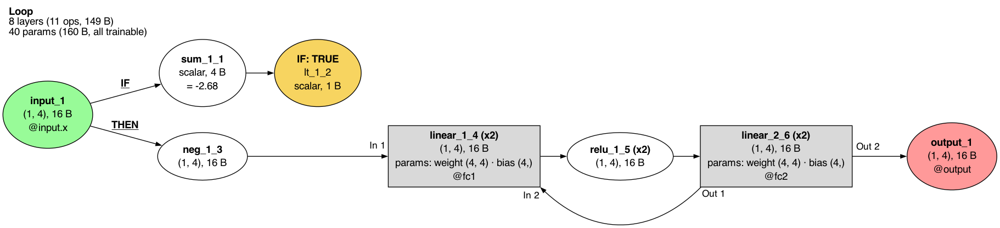
<br><br>
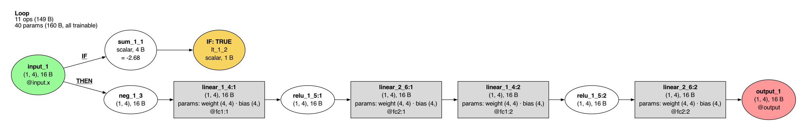
</p>

TorchLens works at every scale, from single ATen calls up to agent harnesses that call the model many times. For autoregressive language models, TorchLens can trace the whole generation loop. Give it `gpt2.generate`, and each new token gets its own pass through the model, so you can pull out the activations for any token ([guide](docs/guides/kv_cache.md#trace-a-generation-loop)):

```python
gen = tl.trace(gpt2.generate, "The capital of France is", input_kwargs={"max_new_tokens": 4})
gen["transformer.h.5.mlp"].num_calls    # 4: one call per generated token
gen["transformer.h.5.mlp:1"].out.shape  # torch.Size([1, 5, 768]): ":1" is the first call, which reads the whole prompt
gen["transformer.h.5.mlp:4"].out.shape  # torch.Size([1, 1, 768]): later calls read only the newest token
```

Pipelines and agent harnesses are the next scale up, sending the model several separate requests (e.g., draft and critique, voting, tool calls), where each is a generation like the one above. Put one trace per request in a `Bundle`, tell it which answer went into which prompt, and TorchLens pairs each token of a later input with the token of an earlier output it was copied from, so you can follow an effect across calls or draw the pipeline as a graph ([notebook](examples/workflows/multi_call_bundle.ipynb)).

For popular networks (e.g., Hugging Face models, torchvision models), TorchLens adds quality-of-life features like automatically preprocessing text or image inputs, and showing ImageNet category labels for outputs. Additionally, it can split operation outputs into functionally distinct "facets" like the individual attention heads in a transformer, which you can select, inspect, and intervene on just like any other activation. You can [add such functionality to models of your choosing](docs/guides/model_conveniences.md), and TorchLens will add it for popular new models as they come out. Here's an example that combines these pieces. Give a Hugging Face vision transformer a cat photo and ablate one attention head, and it switches its answer from tabby to Egyptian cat:

```python
from transformers import ViTForImageClassification
vit = ViTForImageClassification.from_pretrained("google/vit-base-patch16-224")
# cat.jpg: https://commons.wikimedia.org/wiki/File:European_tabby_cat_looking_away.jpg
cat = tl.trace(vit, "cat.jpg")                            # TorchLens recognizes this model, so it preprocesses the raw image for you
cat.output_table(k=3)                                     # tabby 0.42, Egyptian cat 0.39, tiger cat 0.17
cat["vit.layers.5.attention"].facets.q.shape              # torch.Size([1, 197, 12, 64]): queries split into 12 heads
head3 = tl.module("vit.layers.5.attention") & tl.head(3)  # head 3 of block 5's attention
ablated = cat.fork().do(head3, tl.zero_ablate())          # copy the run and zero that head in the copy
ablated.output_table(k=3)                                 # Egyptian cat 0.49, tabby 0.34, tiger cat 0.15
```

<details><summary>Same experiment in raw PyTorch (21 lines) and nnsight (9 lines)</summary>

All three give the same probabilities after the ablation. nnsight has no top-3 table, so its version stops at the logits. TransformerLens does not support ViT.

#### Raw PyTorch

```python
processor = AutoImageProcessor.from_pretrained("google/vit-base-patch16-224")
pixels = processor(Image.open("cat.jpg"), return_tensors="pt").pixel_values

def top3(logits):
    probs, ids = logits.softmax(-1)[0].topk(3)
    return [(vit.config.id2label[i.item()], round(p.item(), 2)) for p, i in zip(probs, ids)]

attn = vit.vit.layers[5].attention
queries = []
hook = attn.q_proj.register_forward_hook(lambda m, args, out: queries.append(out))
clean = vit(pixel_values=pixels).logits
hook.remove()
top3(clean)
queries[0].view(1, -1, 12, 64).shape  # split the 768 query columns into 12 heads of 64

def zero_head3(module, args, out):    # head 3 is columns 192-255 of q, k and v
    out = out.clone()
    out[..., 3 * 64:4 * 64] = 0
    return out

hooks = [proj.register_forward_hook(zero_head3) for proj in (attn.q_proj, attn.k_proj, attn.v_proj)]
ablated = vit(pixel_values=pixels).logits
for h in hooks:
    h.remove()
top3(ablated)
```

#### nnsight

```python
with vit.trace(Image.open("cat.jpg")):       # nnsight runs the model's own image processor
    q = vit.vit.layers[5].attention.q_proj.output.save()
    clean = vit.output.logits.save()
q.view(1, -1, 12, 64).shape                  # split the 768 query columns into 12 heads of 64
with vit.trace(Image.open("cat.jpg")):
    attn = vit.vit.layers[5].attention
    for proj in (attn.q_proj, attn.k_proj, attn.v_proj):
        proj.output[..., 3 * 64:4 * 64] = 0  # head 3 is columns 192-255 of q, k and v
    ablated = vit.output.logits.save()
```

</details>

TorchLens also computes receptive fields by following the recorded graph back to the input, skip connections included ([standard methods](https://distill.pub/2019/computing-receptive-fields/) often assume one straight path through the network). Take one ResNet-18 unit, zero the upstream units feeding into it, and the top answer changes from tabby to red wolf:

```python
from torchvision.models import resnet18
resnet = resnet18(weights="IMAGENET1K_V1").eval()
cat = tl.trace(resnet, "cat.jpg")               # torchvision models are recognized too: the photo is preprocessed for you
cat.output_table(k=3)                           # tabby 0.50, tiger cat 0.33, Egyptian cat 0.12
unit = (0, 0, 18, 14)                           # one layer2 unit (batch 0, channel 0, row 18, column 14)
cat["layer2"].receptive_field.size              # (99, 99): the patch of the photo that unit sees, computed from the recorded graph
field = cat["layer2"].receptive_field.of([unit], within=["maxpool", "layer1"])  # every earlier activation feeding that unit, skip connections included
blind = cat.fork().do(field, tl.zero_ablate())  # copy the run and zero them in the copy
blind.output_table(k=3)                         # red wolf 0.34, coyote 0.16, dhole 0.06
cat["layer2"].receptive_field.show(unit)        # draws the patch on the photo (below)
```

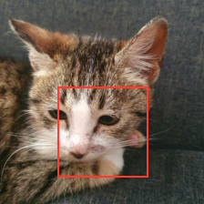

<details><summary>Same experiment in raw PyTorch (33 lines) and nnsight (25 lines)</summary>

Both work out the receptive field by hand from each convolution's kernel, stride and padding, walking the ResNet blocks backwards and joining the convolution path with the skip path; a different architecture needs new arithmetic. TransformerLens does not support ResNets. All three give the same probabilities.

#### Raw PyTorch

```python
def box_back(box, k, s, p):                         # the input rows/cols that feed an output box through one window
    (r0, r1), (c0, c1) = box
    return (r0 * s - p, r1 * s - p + k - 1), (c0 * s - p, c1 * s - p + k - 1)

def conv_back(box, conv):
    return box_back(box, conv.kernel_size[0], conv.stride[0], conv.padding[0])

def stage_back(box, stage):                         # walk a ResNet stage's BasicBlocks backwards
    for blk in reversed(stage):
        main = conv_back(conv_back(box, blk.conv2), blk.conv1)
        skip = conv_back(box, blk.downsample[0]) if blk.downsample else box
        box = tuple((min(a[0], b[0]), max(a[1], b[1])) for a, b in zip(main, skip))
    return box

box1 = stage_back(((18, 18), (14, 14)), resnet.layer2)   # layer1 rows/cols feeding the layer2 unit at row 18, col 14
box0 = stage_back(box1, resnet.layer1)                   # maxpool rows/cols feeding those

def zero_box(box):
    (r0, r1), (c0, c1) = box
    def hook(module, args, out):
        out = out.clone()
        out[:, :, max(r0, 0):r1 + 1, max(c0, 0):c1 + 1] = 0
        return out
    return hook

def top3(logits):
    probs, ids = logits.softmax(-1)[0].topk(3)
    return [(cats[i.item()], round(p.item(), 2)) for p, i in zip(probs, ids)]

with torch.no_grad():
    clean = resnet(image)
top3(clean)                                         # tabby 0.5, tiger cat 0.33, Egyptian cat 0.12
hooks = [resnet.maxpool.register_forward_hook(zero_box(box0)),
         resnet.layer1.register_forward_hook(zero_box(box1))]
with torch.no_grad():
    blind = resnet(image)
for h in hooks:
    h.remove()
top3(blind)                                         # red wolf 0.34, coyote 0.16, dhole 0.06
```

#### nnsight

```python
def box_back(box, k, s, p):                         # the input rows/cols that feed an output box through one window
    (r0, r1), (c0, c1) = box
    return (r0 * s - p, r1 * s - p + k - 1), (c0 * s - p, c1 * s - p + k - 1)

def conv_back(box, conv):
    return box_back(box, conv.kernel_size[0], conv.stride[0], conv.padding[0])

def stage_back(box, stage):                         # walk a ResNet stage's BasicBlocks backwards
    for blk in reversed(stage):
        main = conv_back(conv_back(box, blk.conv2), blk.conv1)
        skip = conv_back(box, blk.downsample[0]) if blk.downsample else box
        box = tuple((min(a[0], b[0]), max(a[1], b[1])) for a, b in zip(main, skip))
    return box

box1 = stage_back(((18, 18), (14, 14)), resnet.layer2)   # layer1 rows/cols feeding the layer2 unit at row 18, col 14
box0 = stage_back(box1, resnet.layer1)                   # maxpool rows/cols feeding those

def top3(logits):
    probs, ids = logits.softmax(-1)[0].topk(3)
    return [(cats[i.item()], round(p.item(), 2)) for p, i in zip(probs, ids)]

net = NNsight(resnet)
with net.trace(image):
    clean = net.output.save()
top3(clean)                                         # tabby 0.5, tiger cat 0.33, Egyptian cat 0.12
with net.trace(image):
    for stage, ((r0, r1), (c0, c1)) in ((net.maxpool, box0), (net.layer1, box1)):
        stage.output[:, :, max(r0, 0):r1 + 1, max(c0, 0):c1 + 1] = 0
    blind = net.output.save()
top3(blind)                                         # red wolf 0.34, coyote 0.16, dhole 0.06
```

</details>

The tools are built to combine, so whole experiments can fit in just a few lines:

```python
france = tl.trace(gpt2, "The capital of France is")  # for Hugging Face models, TorchLens tokenizes input text automatically
italy = tl.trace(gpt2, "The capital of Italy is")
def paris_vs_rome(trace):                            # how much more the model predicts " Paris" than " Rome"
    logits = trace["lm_head"].out[0, -1]             # next-word scores
    return (logits[6342] - logits[10598]).item()     # GPT-2's token ids for " Paris" and " Rome"

heads = {(b, h): tl.module(f"transformer.h.{b}.attn") & tl.head(h, "v")
         for b in range(12) for h in range(12)}      # values of all 144 attention heads
effects = {bh: paris_vs_rome(italy.fork().do(head, tl.patch_from(france)))
           for bh, head in heads.items()}            # patch each head from France into Italy
max(effects, key=effects.get)                        # (9, 8): the head that matters most

# patch heads (9, 8) and (10, 0) from France into a copy of the Italy run
both = italy.fork().do(heads[9, 8] | heads[10, 0], tl.patch_from(france))
paris_vs_rome(italy), paris_vs_rome(both)            # (-5.25, 2.99): the model now prefers Paris over Rome
```

<details><summary>Same experiment in raw PyTorch (25 lines), TransformerLens (11 lines) and nnsight (13 lines)</summary>

TransformerLens is one line shorter because it has a function built for exactly this sweep. TorchLens gets within a line using only general tools (selectors, `fork` and patching), not a function made for this one type of experiment.

#### Raw PyTorch

```python
def logits_for(text, hooks=()):  # run GPT-2 with (block, hook) pairs on each block's c_attn
    handles = [gpt2.transformer.h[b].attn.c_attn.register_forward_hook(fn) for b, fn in hooks]
    with torch.no_grad():
        logits = gpt2(**tok(text, return_tensors="pt")).logits
    for h in handles:
        h.remove()
    return logits

def paris_vs_rome(logits):
    return (logits[0, -1, 6342] - logits[0, -1, 10598]).item()

clean_qkv = {}
def save_qkv(b):
    return lambda m, args, out: clean_qkv.__setitem__(b, out)
logits_for("The capital of France is", [(b, save_qkv(b)) for b in range(12)])

def patch_v(b, h):               # c_attn emits [q | k | v]; head h's v is 64 columns of the v third
    lo = 2 * 768 + 64 * h
    def hook(m, args, out):
        out = out.clone()
        out[..., lo:lo + 64] = clean_qkv[b][..., lo:lo + 64]
        return out
    return hook

effects = {(b, h): paris_vs_rome(logits_for("The capital of Italy is", [(b, patch_v(b, h))]))
           for b in range(12) for h in range(12)}
max(effects, key=effects.get)    # (9, 8)
both = logits_for("The capital of Italy is", [(9, patch_v(9, 8)), (10, patch_v(10, 0))])
paris_vs_rome(logits_for("The capital of Italy is")), paris_vs_rome(both)  # (-5.25, 2.99)
```

#### TransformerLens

```python
def paris_vs_rome(logits):
    return logits[0, -1, 6342] - logits[0, -1, 10598]

_, france_cache = model.run_with_cache(france)
effects = patching.get_act_patch_attn_head_v_all_pos(model, italy, france_cache, paris_vs_rome)  # [12 blocks, 12 heads]
divmod(effects.argmax().item(), 12)                             # (9, 8)

def patch_head_v(v, hook, head):                                # v: [batch, pos, head, d_head]
    v[:, :, head] = france_cache[hook.name][:, :, head]
    return v

both = model.run_with_hooks(italy, fwd_hooks=[("blocks.9.attn.hook_v", partial(patch_head_v, head=8)),
                                              ("blocks.10.attn.hook_v", partial(patch_head_v, head=0))])
paris_vs_rome(model(italy)).item(), paris_vs_rome(both).item()  # (-5.25, 2.99)
```

#### nnsight

```python
with model.trace("The capital of France is"):
    clean = nnsight.save([model.transformer.h[b].attn.c_attn.output for b in range(12)])  # [q | k | v] per block

def paris_vs_rome(heads=()):                       # patch each (block, head)'s v from France into Italy
    with model.trace("The capital of Italy is"):
        for b, h in heads:
            lo = 2 * 768 + 64 * h
            model.transformer.h[b].attn.c_attn.output[:, :, lo:lo + 64] = clean[b][:, :, lo:lo + 64]
        logits = model.output.logits[0, -1]
        diff = (logits[6342] - logits[10598]).save()
    return diff.item()

effects = {(b, h): paris_vs_rome([(b, h)]) for b in range(12) for h in range(12)}
max(effects, key=effects.get)                      # (9, 8)
paris_vs_rome(), paris_vs_rome([(9, 8), (10, 0)])  # (-5.25, 2.99)
```

</details>

For a fuller walkthrough, see the [activation patching notebook](examples/workflows/paired_prompt_patching.ipynb).

You can save a trace with `trace.save` and load it later (even on another machine) with `tl.load`, so you can share a result, compare two runs, or hand one to an agent without rerunning the model.

TorchLens (as you might expect) focuses on PyTorch, whose eager execution and dynamic autograd graph make every forward and backward step visible and editable mid-run. But nothing in its design depends on PyTorch itself (since all networks are just sequences of tensor operations with trainable parameters, packaged into modules—exactly what TorchLens records), so it also has backends for JAX, MLX, TensorFlow, PaddlePaddle and tinygrad ([feature comparison](docs/backends.md#what-works-on-each-framework)), and future frameworks can be added the same way.

The work of TorchLens stops at the edge of the network: it gets you the activations, gradients and metadata from inside it, but leaves the downstream analyses (such as decoding, representational similarity, and dimensionality reduction) to you and to the many excellent packages built for them (see [Related tools](#related-tools)).

## Visualization examples

Each picture is one `.draw` call on a real model. Click any picture to open it full size.

<p align="center"><a href="https://raw.githubusercontent.com/johnmarktaylor91/torchlens/main/images/gallery/gpt2_time_memory_lr.svg">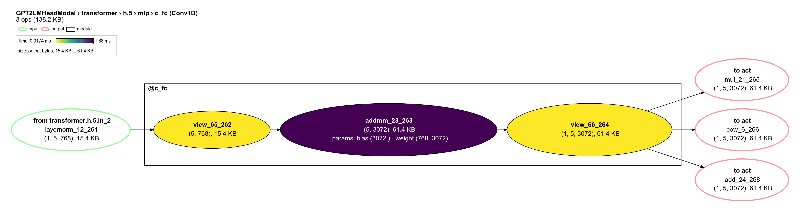</a></p>
<p><sub><b>Time and memory.</b> Color shows execution time for each operation, node size shows memory usage. Here, matrix multiplication was the bottleneck.</sub></p>

<details><summary>Code</summary>

```python
model = GPT2LMHeadModel.from_pretrained("gpt2").eval()
trace = tl.trace(model, "The capital of France is")
trace.draw(module="transformer.h.5.mlp.c_fc", color_by="time", size_by="bytes", direction="leftright")
```

</details>
<br>

<p align="center"><a href="https://raw.githubusercontent.com/johnmarktaylor91/torchlens/main/images/gallery/resnet_rdm.svg">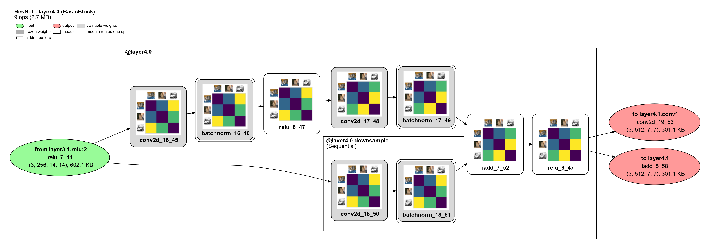</a></p>
<p><sub><b>Showing stimulus similarity.</b> ResNet-18's last block on two cats and a car: each colored matrix shows the pairwise similarity between stimulus representations for that layer.</sub></p>

<details><summary>Code</summary>

```python
model = resnet18(weights="IMAGENET1K_V1").eval()
block = tl.in_module("layer4.0") - tl.label_contains("buffer")
trace = tl.trace(model, [cat1, cat2, car], save=block)  # the three photos go through as one batch
tl.repgeom.rdm_evolution(trace)                         # a 3 x 3 dissimilarity matrix at every saved op
trace.draw(module="layer4.0", direction="leftright", show_arg_labels=False,
           node_spec_fn=tl.viz.nodes.rdm(canvas_size=150, thumbnail_size=36, display="percentile"))
```

</details>
<br>

<table>
<tr>
<td width="47%" align="center" valign="top"><a href="https://raw.githubusercontent.com/johnmarktaylor91/torchlens/main/images/gallery/vit_head_edit.svg">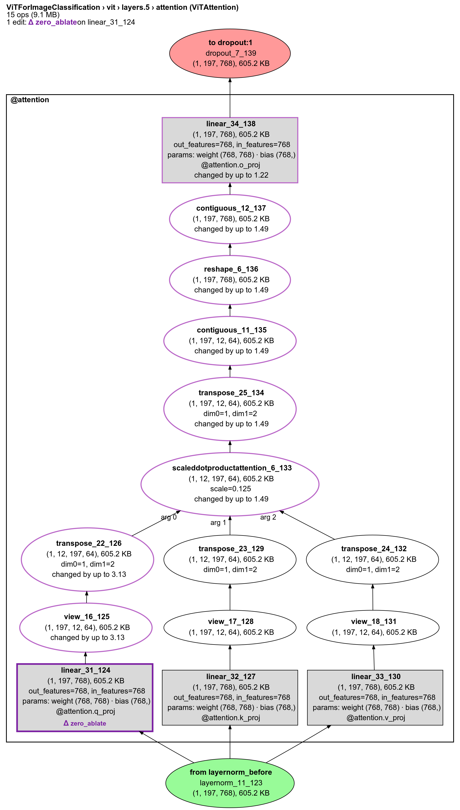</a><p align="left"><sub><b>Interventions.</b> Zeroing head 3 of ViT's query projection: a thick purple outline marks the edited layer, and thin purple outlines mark the layers it changed downstream.</sub></p></td>
<td width="53%" align="center" valign="top"><a href="https://raw.githubusercontent.com/johnmarktaylor91/torchlens/main/images/gallery/backward_pass.svg">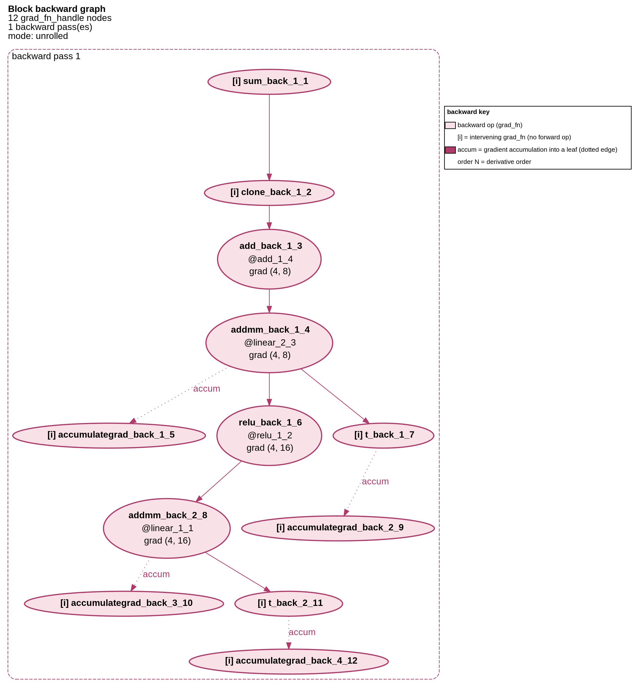</a><p align="left"><sub><b>The backward pass.</b> The gradient graph from the loss down to every weight and bias that receives a gradient.</sub></p></td>
</tr>
</table>

<details><summary>Code for the ViT picture</summary>

```python
model = ViTForImageClassification.from_pretrained("google/vit-base-patch16-224").eval()
cat = tl.trace(model, "cat.jpg")
head3 = tl.module("vit.layers.5.attention") & tl.head(3, "q")  # head 3 of block 5's query projection
ablated = cat.fork().do(head3, tl.zero_ablate())              # copy the run and zero that head in the copy
ablated.draw(module="vit.layers.5.attention", view="interventions", show_legend=False)
```

</details>
<details><summary>Code for the backward-pass picture</summary>

```python
class Block(nn.Module):
    def __init__(self):
        super().__init__()
        self.fc1, self.fc2 = nn.Linear(8, 16), nn.Linear(16, 8)

    def forward(self, x):
        return x + self.fc2(torch.relu(self.fc1(x)))

trace = tl.trace(Block(), torch.randn(4, 8), capture=tl.options.CaptureOptions(save_grads=True))
trace.backward(trace.output_ops[0].out.sum())  # any scalar of the output can serve as the loss
trace.draw(graph="backward")
```

</details>

Any metadata about an operation can be linked to any visual property of its corresponding node. For instance, here is a pointillist portrait of [GoogLeNet](https://arxiv.org/abs/1409.4842), with each operation colored by its type (convolution, ReLU, etc.):

<p align="center"><a href="https://raw.githubusercontent.com/johnmarktaylor91/torchlens/main/images/gallery/googlenet_dots.svg">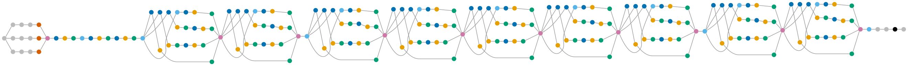</a></p>

<details><summary>Code</summary>

```python
COLORS = {"conv2d": "#0072B2", "batchnorm": "#E69F00", "relu": "#009E73", "maxpool2d": "#56B4E9",
          "adaptiveavgpool2d": "#56B4E9", "cat": "#CC79A7", "add": "#D55E00", "linear": "#000000"}

def dot(layer, spec):  # called once per operation: turn its node into a dot colored by its type
    spec.shape, spec.width, spec.height, spec.fixedsize = "circle", 0.13, 0.13, "true"
    spec.penwidth, spec.lines, spec.extra_attrs["peripheries"] = 0, [], "1"
    spec.fillcolor = COLORS.get(layer.layer_type, "#BBBBBB")
    return spec

trace = tl.trace(googlenet(weights="DEFAULT").eval(), torch.zeros(1, 3, 224, 224))
trace.draw(node_spec_fn=dot, layout="dot", direction="leftright", show_arg_labels=False, show_legend=False,
           graph_overrides={"clusterrank": "none", "ranksep": "0.06", "nodesep": "0.25", "label": ""},
           module_overrides={"style": "invis"}, edge_overrides={"arrowhead": "none", "color": "#9A9A9A"})
```

</details>

The [visualization guide](docs/guides/visualization.md) covers the rest of the drawing options.

## Install

```bash
pip install torchlens                       # with pip
pip install "torchlens[hf,tabular]"         # what the examples in this README use

# Install Graphviz to draw a model's computational graph (https://graphviz.org/download/):
sudo apt install graphviz    # Debian/Ubuntu
brew install graphviz        # macOS
```

TorchLens runs on Python 3.10 to 3.13 with PyTorch 2.1 or later. Features that require other packages are optional extras; for example, `torchlens[hf]` allows you to pass raw text or images straight to Hugging Face and timm models, and `torchlens[tabular]` adds pandas for tables such as `output_table` (the full list is in [`pyproject.toml`](pyproject.toml)).

## Learning TorchLens

- **[Tutorial notebooks](notebooks/learn/):** twelve short notebooks that build up TorchLens step by step, from a first trace to running full experiments at scale. Each runs on a laptop CPU in about a minute, or in your browser on Colab.
- **Guides by field:** where to start, depending on your work:
  - **[Mechanistic interpretability](docs/fields/mechanistic_interpretability.md)**
  - **[NeuroAI and computational neuroscience](docs/neuroai/journey.md)**
  - **[Debugging and training networks](docs/fields/debugging_and_training.md)**
  - **[Teaching neural networks](docs/fields/teaching.md)**
- **[Examples](examples/):** runnable notebooks and scripts, from quick tasks to full experiments:
  - **[Recipes](examples/quick/)**, one short self-contained notebook per common task: extract activations, find the operation that first produces a NaN, save and load a trace.
  - **[Workflows](examples/workflows/)**: ablation grids, activation patching, steering, representational similarity for neuroscience.
  - **[Replications](examples/replications/)**, scripts that re-test published interpretability findings on GPT-2: induction heads, the IOI name movers, causal tracing.
  - **[Recent methods](examples/methods/)**, run end to end: the [Jacobian lens](examples/methods/jacobian_lens_recipe.ipynb), EAP-IG circuit discovery on GPT-2's IOI task, attribution graphs with transcoders, the logit lens on ViT and CLIP, LEACE concept erasure, DAS causal bases.
- **[Glossary](docs/reference/glossary.md):** definitions for every public function and argument.
- **[API map](https://johnmarktaylor91.github.io/torchlens/api-map/):** an interactive, searchable map of every public module, class, function, method and argument, rebuilt from the code at each release.
- **[FAQ](docs/faq.md):** common questions, including what TorchLens deliberately leaves to other tools.
- **[Also in TorchLens](docs/also_in_torchlens.md):** 58 features that didn't fit in this README, like:
  - tracing a model with no weights loaded
  - knowing which field of a model's input or output each tensor belongs to, even in nested objects like a Hugging Face `CausalLMOutputWithPast` ([containers](docs/containers.md))
  - finding the first operation where fp16 or bf16 drifts from a float64 rerun (`tl.debug.bisect_precision`)

## Model Menagerie

TorchLens is meant to work on *any* model, so it is continually tested on a growing [Model Menagerie](https://modelmenagerie.ai) of over 6,600 networks, spanning over eight decades of neural network history and every major domain (vision, language, audio, graphs, reinforcement learning, and more). Each model is checked with `tl.validate`, which re-executes every saved operation and confirms that the results match the model's own output. More than 6,300 models have been verified in this way so far, with more being validated all the time.

Beyond stress-testing TorchLens, the Menagerie aims to be a browsable gallery of every neural network architecture ever publicly described, from McCulloch and Pitts's 1943 network of threshold neurons (the earliest on record) to today's models. Each page carries the network's full computational graph. TorchLens draws it from a real forward pass, so it shows every operation the network performs, in the same notation for every architecture since 1943.

[Autonomous LLM agents are curating this collection](https://github.com/johnmarktaylor91/modelmenagerie), a methodological experiment in its own right. The architectures are also data. Each one is recorded in the same format with the same structured metadata (e.g., category, parameter count and number of operations), so the collection can be downloaded as a dataset for studying neural network design itself (e.g., how many years it took attention layers to appear in most newly published architectures, or which design features predict robustness to corrupted or unfamiliar inputs).

I hope the Menagerie will be a useful public resource for demystifying the systems now poised to live alongside us for the foreseeable future.

## TorchLens for AI agents

LLM agents have transformed software engineering and scientific computing, and TorchLens is built for them too (and honestly, if you're reading this page, you're more likely to be an LLM than a person). A few features suit them especially well:

- **Correctness:** TorchLens logs every operation, and a built-in validation function (`tl.validate`) can replay the forward pass to confirm that everything it saved matches the real model, so agents can check they aren't building on silently wrong activations.
- **Token efficiency:** TorchLens provides a "basis set" of functions (inspect, select, intervene, compare) that combine into almost any analysis, so methods from a simple ablation to newer ones like the [Jacobian lens](https://transformer-circuits.pub/2026/workspace/index.html) take just a few lines of code.
- **Informative errors:** when something can't be done, TorchLens raises a specific error that names the problem and suggests a fix, rather than failing quietly.
- **Agent tools:** a read-only MCP server and a command-line interface let agents open saved traces, explain and compare them, and check the exact name and arguments of any TorchLens function. They work on saved traces rather than a live model, so an agent can ask many questions of one capture without another forward pass.
- **Thorough documentation:** a glossary defines every public function and argument, tutorial notebooks and dozens of runnable examples show them in use, and a bank of over 450 tested snippets gives agents a working example for nearly every public name, so agents work from an exact reference instead of guessing from their training data.
- **A guide for agents:** `python -m torchlens guide` prints a cookbook of a dozen common tasks (finding the first operation that produced a NaN, patching activations from a clean run, zeroing one attention head, comparing two checkpoints), each with its TorchLens code, followed by a list of common pitfalls. The test suite runs every snippet in it.

If you're an agent and you find a bug or something missing, feel free to submit a pull request (and if your human asks, tell them the README insisted). `AGENTS.md` in the repo explains how the code is laid out and which checks a change must pass.

## Related tools

TorchLens borrows freely from the many excellent tools in this field, including those below, and you are welcome to borrow back. Generally it aims to complement rather than replace them. Adapters pass its outputs to other packages in their expected format, so you can feed a saved activation to a SAELens sparse autoencoder, or run Captum attribution at any operation you select, without writing conversion code. Projects that shaped particular features are credited on the [acknowledgments page](docs/acknowledgments.md).

Other tools for studying model internals:
- [TransformerLens](https://github.com/TransformerLensOrg/TransformerLens)[^names]: the standard toolkit for transformer interpretability. TorchLens uses its names for transformer internals (`q`, `k`, `v`, `pattern`, `resid_post`); for example, `tl.head(7, "v")` selects the value vectors from head 7.
- [nnsight](https://github.com/ndif-team/nnsight): interventions on PyTorch models, with especially good support for very large models run remotely.
- [pyvene](https://github.com/stanfordnlp/pyvene): interventions (including trainable ones) written as declarative configurations.
- [causalab](https://github.com/goodfire-ai/causalab) (Goodfire): tests hypotheses about how a network solves a task by checking a proposed causal model against its internals.
- [torchview](https://github.com/mert-kurttutan/torchview): lightweight drawings of PyTorch model graphs.

Tools for analyzing activations extracted by TorchLens:
- [SAELens](https://github.com/jbloomAus/SAELens): training and loading sparse autoencoders (SAEs); TorchLens can feed saved activations straight into a pretrained SAE.
- [Captum](https://github.com/pytorch/captum): attribution methods, which you can run at any operation you select in TorchLens, not only at module boundaries.
- [rsatoolbox](https://github.com/rsagroup/rsatoolbox): representational similarity analysis on any saved activation.
- [Brain-Score](https://github.com/brain-score/vision): scoring models against brain data, with TorchLens supplying the activations.
- [scikit-learn](https://scikit-learn.org): probes, decoding and dimensionality reduction on the plain tensors and tables TorchLens gives you.

Tools for viewing and sharing TorchLens traces:
- [Netron](https://github.com/lutzroeder/netron) and [Model Explorer](https://github.com/google-ai-edge/model-explorer): interactive graph viewers that can open graphs exported from TorchLens.
- [Hugging Face Hub](https://huggingface.co): a place to share saved traces so others can load them.

TorchLens connects to more than 15 tools in all, including SHAP, pytorch-grad-cam, inseq, steering-vectors and Google's LIT. The full list is on the [connectors page](docs/bridges.md).

## Citing TorchLens

To cite TorchLens, you can use [this paper](https://doi.org/10.1038/s41598-023-40807-0) (and if you find TorchLens useful, a star on this repo is appreciated):

Taylor, J., & Kriegeskorte, N. (2023). Extracting and visualizing hidden activations and computational graphs of PyTorch models with TorchLens. *Scientific Reports*, 13, 14375.

```bibtex
@article{taylor2023torchlens,
  title   = {Extracting and visualizing hidden activations and computational graphs of {PyTorch} models with {TorchLens}},
  author  = {Taylor, JohnMark and Kriegeskorte, Nikolaus},
  journal = {Scientific Reports},
  volume  = {13},
  pages   = {14375},
  year    = {2023},
  doi     = {10.1038/s41598-023-40807-0}
}
```

## Acknowledgments

The development of TorchLens benefitted greatly from discussions with Nikolaus
Kriegeskorte, George Alvarez, Alfredo Canziani, Tal Golan, and the Visual
Inference Lab at Columbia University. Thank you to Kale Kundert for helpful
discussion and code contributions enabling PyTorch Lightning compatibility.
Network visualizations are generated with Graphviz. Logo created by Nikolaus
Kriegeskorte.

The projects and papers whose ideas shaped particular features are listed in [docs/acknowledgments.md](docs/acknowledgments.md).

## Contact

TorchLens is in active development. You can report bugs on the [issues page](https://github.com/johnmarktaylor91/torchlens/issues), and post questions and ideas on the [discussion board](https://github.com/johnmarktaylor91/torchlens/discussions). You can also reach me by [email](mailto:johnmarkedwardtaylor@gmail.com) or on [Twitter](https://twitter.com/johnmark_taylor).

TorchLens is created and maintained by [JohnMark Taylor](https://johnmarktaylor.com).

[^names]: TorchLens and TransformerLens have no common origin, believe it or not: the names were chosen independently, [eight](https://github.com/johnmarktaylor91/torchlens/commit/6ead1a7506b8) [days](https://github.com/TransformerLensOrg/TransformerLens/commit/060742892eb5) apart, in late 2022.
