# Reading and drawing TorchLens graphs

`trace.draw()` turns a trace into a picture of everything the model computed: one node per
operation, one arrow per tensor passed from one operation to the next, and a box around the
operations each module ran. This page explains how to read that picture and what each drawing
option changes, with a real drawing for every option.

Every image on this page is drawn by `docs/guides/visualization_figures.py`, which sits
beside this page in the repository: `python docs/guides/visualization_figures.py` redraws them
all. The code line under each image
is the exact call that drew it, and clicking an image opens it at full size. The models are deliberately tiny so that each drawing fits the
page; for drawings of real architectures, see the
[Model Menagerie](https://modelmenagerie.ai).

```text
import torchlens as tl

trace = tl.trace(model, x)       # run the model once and record every operation
trace.draw("my_model")           # write my_model.pdf; returns a Drawing
trace.draw("my_model", file_format="png", dpi=110)
```

With a path, `draw` writes a file: PDF unless the extension or `file_format=` picks another
Graphviz format. With no path, a notebook displays the drawing inline. Either way it returns a
`Drawing` whose `dot` attribute holds the Graphviz source. Drawing requires the Graphviz
program to be installed.

## Your first drawing

[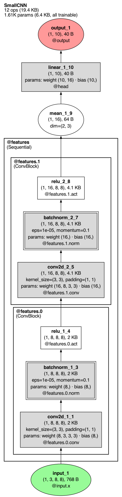](../images/visualization/first_drawing.png)

`trace.draw()`

The graph flows from the input at the bottom to the output at the top. The header in the top
left corner names the model and counts the whole network, whatever the drawing collapses: 12
operations (19.4 KB of outputs; two of them, the batch norms' step-counter updates, are hidden
with the buffers) and 1.61K parameters, all trainable. Large counts print compact (`86.6M params`,
`12.3K ops`). Each thick-bordered box is one module call: here
`@features` (an `nn.Sequential`) holds two `ConvBlock` modules, `@features.0` and
`@features.1`. The name under each box's address is the module's class.

## Reading a node

[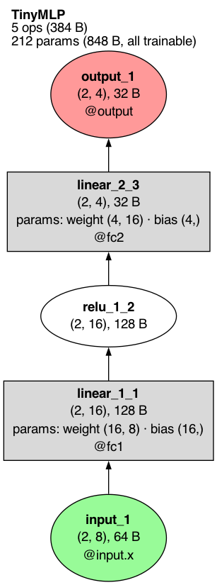](../images/visualization/node_anatomy.png)

`trace.draw()`

Each node is one operation, or a model input or output. Its rows, top to bottom:

- **Name** (bold), for example `linear_1_1` or `relu_1_2`. The name is
  `<operation>_<n>_<step>`: `relu_1_2` is the first `relu` in the model and the second
  operation it ran. Counting is by layer, in the order layers first ran, so in a large model
  `tanh_6_270` is the sixth distinct `tanh` and the 270th layer. Inputs and outputs are
  numbered on their own (`input_1`, `output_1`). The name is the key you use to read that
  operation back: `trace["relu_1_2"]`.
- **Output shape and size**: `(2, 16), 128 B` means the output tensor has shape `(2, 16)` and
  takes 128 bytes. A scalar output reads `scalar`, and its value is printed under it
  (`= -0.492`).
- **Arguments** that change what the operation does, when they differ from the defaults: for
  example `kernel_size=(3, 3), padding=(1, 1)` on a convolution or `dim=(2, 3)` on a mean.
- **Parameters**, when the operation used any: `params: weight (16, 8) · bias (16,)` gives each
  parameter's name and shape. Round brackets mean the parameter is trainable; square brackets,
  as in `weight [8, 8]`, mean it is frozen (`requires_grad=False`).
- **Address**, starting with `@`, on rectangles, inputs and outputs: `@fc1` means the node is
  the output of the module `model.fc1`; `@input.x` means the model's argument `x`. On a
  recurrent model the address can carry the call numbers: `@inp:1,2,3` is calls 1, 2 and 3 of
  module `inp`. A plain operation (an ellipse) has no address row; the box drawn around it
  names its module.

The shape of the node says what kind of record it is. An ellipse is a plain operation such as
`torch.relu` or `x.mean()`. A rectangle is an operation that was a module call's whole work: a
module that ran as one operation, such as an `nn.Linear` or `nn.Conv2d`, or the one operation
a module ran itself while the rest ran in its submodules (the residual `add` of a block, in
the [collapse](#collapsing-large-models) drawings). A double-bordered rectangle
(`batchnorm_1_3` in the first drawing) is such a module that also uses buffers. A `node_spec_fn` callback can drop that double border by setting `spec.extra_attrs["peripheries"] = "1"`. A three-dimensional box is a whole module drawn as one node (see
[module depth](#module-depth)), and a cylinder is a buffer (see [buffers](#buffers)).

When the trace was captured from a photo, `tl.trace(model, "cat.jpg")` or a PIL image, the
input node shows a small thumbnail of it above its rows. `trace.batch_render = "shape_only"`
(or `CaptureOptions(batch_render="shape_only")`) draws the plain node instead. Any node that
carries a picture (the input photo, an `annotate(image=...)` picture, a layer thumbnail) draws
as a rounded box in its usual fill with the picture in its own cell above the text, and so does
an output node that lists decoded labels.

## Fill colors

[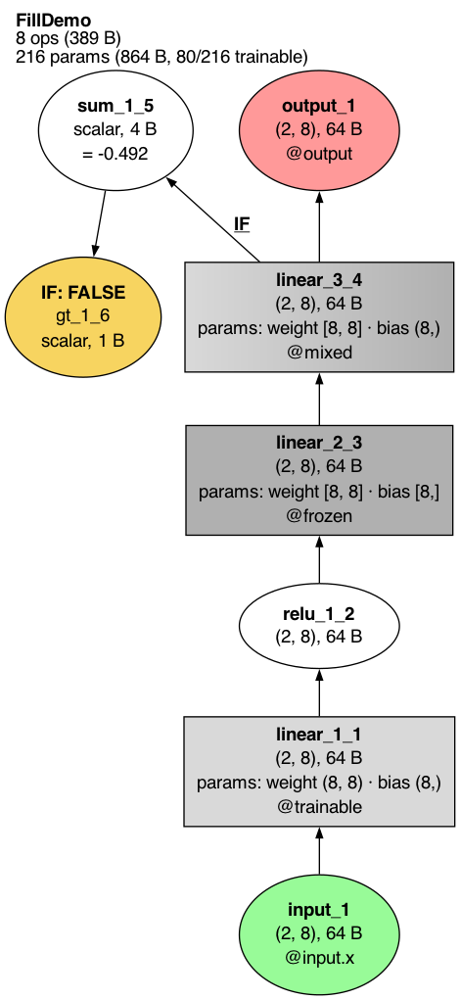](../images/visualization/fills.png)

`trace.draw()`

The default drawing uses six fills:

| Fill | Meaning | In the drawing |
|---|---|---|
| Pale green | a model input | `input_1` |
| Salmon | a model output | `output_1` |
| Light grey | uses trainable parameters | `linear_1_1` (`@trainable`) |
| Dark grey | uses frozen parameters | `linear_2_3` (`@frozen`) |
| Light-to-dark grey | uses both trainable and frozen parameters | `linear_3_4` (`@mixed`: frozen weight, trainable bias) |
| Yellow | a true/false test that decided a branch (see [branches](#branches-if-and-then)) | `gt_1_6` |
| White | every other operation | `relu_1_2`, `sum_1_5` |

`show_legend=True` adds a key for the fills and shapes the drawing uses:

[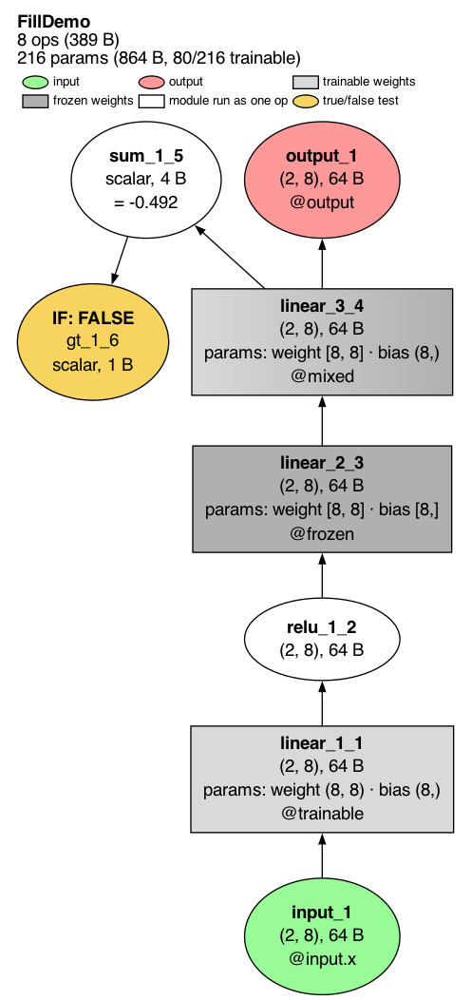](../images/visualization/legend.png)

`trace.draw(show_legend=True)`

With the default `show_legend=None`, a legend appears only when a [color or size
channel](#color-and-size-by-any-value) is on, and as a reading key on a [module
focus](#focusing-on-one-module) drawing. `show_legend=False` never draws one.

## Branches: IF and THEN

When Python code inside `forward` branches on a tensor (`if x.mean() > 0:`), TorchLens records
the comparison that decided it and marks the branch on the drawing.

[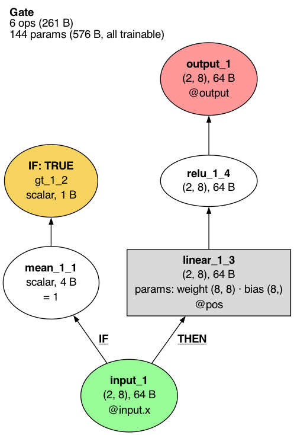](../images/visualization/branch.png)

`trace.draw()`

```text
def forward(self, x):
    if x.mean() > 0:
        return torch.relu(self.pos(x))
    return -self.neg(x)
```

The yellow node `gt_1_2` is the comparison `> 0`; its first row, `IF: TRUE`, says it was the
condition of an `if` and that it came out true. The arrow into `linear_1_3` is labelled
**THEN**: that is the first operation of the branch the condition chose. The branch not taken
(`self.neg`) never ran, so it is not in the drawing. In the fill drawing above, `IF: FALSE`
marks a test that came out false, so its branch body is absent.

## Loops: unrolled and rolled

A model that applies the same layer several times, like a recurrent network, can be drawn two
ways. The model here runs one cell three times:

```text
h = torch.zeros_like(x)
for _ in range(3):
    h = torch.tanh(self.inp(x) + self.rec(h))
```

By default each pass is its own node (unrolled):

[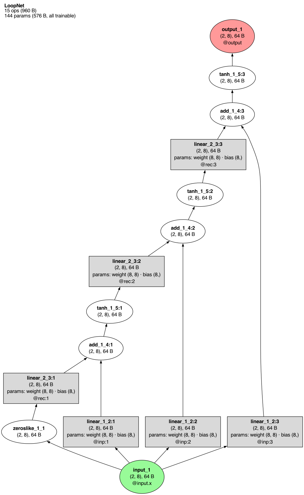](../images/visualization/unrolled.png)

`trace.draw()`

The number after the colon is the pass: `tanh_1_5:2` is the second time layer `tanh_1_5` ran,
and `@rec:2` is the second call of module `rec`.

`rolled=True` draws each layer once and turns the repetition into a loop:

[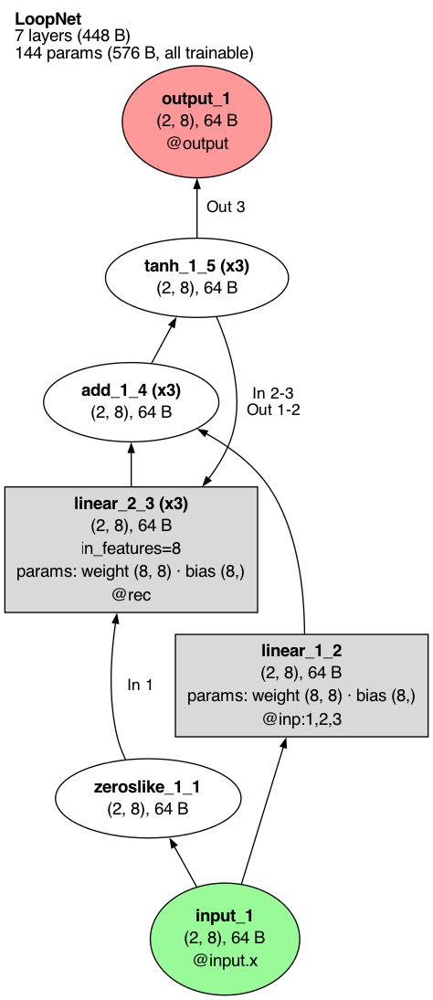](../images/visualization/rolled.png)

`trace.draw(rolled=True)`

`(x3)` after a name says the layer ran three times. An arrow that only some passes used is
labelled with those passes: `In 1` on the arrow from `zeroslike_1_1` means only the first pass
of `linear_2_3` read the initial zeros, and `In 2-3` / `Out 1-2` on the arrow from `tanh_1_5`
back to `linear_2_3` means passes 1 and 2 of `tanh_1_5` fed passes 2 and 3 of `linear_2_3`.
`Out 3` means only the last pass of `tanh_1_5` became the output. An arrow with no label was
used on every pass.

## Module depth

`depth=` sets how many levels of the module tree are drawn open. Modules deeper than that are
each drawn as a single three-dimensional box.

[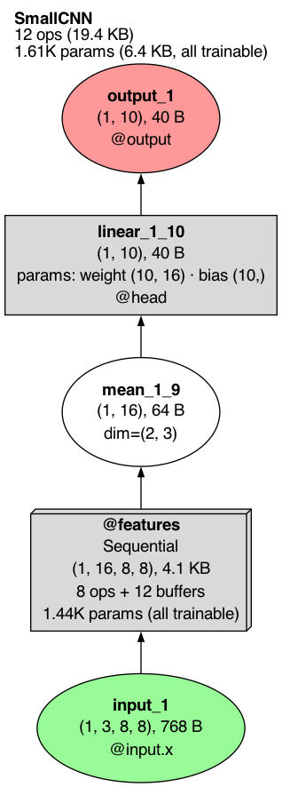](../images/visualization/depth_1.png)

`trace.draw(depth=1)`

[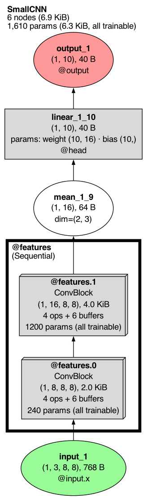](../images/visualization/depth_2.png)

`trace.draw(depth=2)`

A collapsed box reads like a node: the module's address and class, its output shape and size,
how many operations and buffer versions it hides (`4 ops + 6 buffers`), and its parameter count. The
default, `depth=1000`, opens every module, as in [the first drawing](#your-first-drawing).

## Collapsing large models

`depth=` cuts the module tree at one level everywhere. `collapse=` instead decides module by
module how much to fold, to keep a large graph readable. It takes `"none"` (the default, every
operation drawn), `"auto"`, `"max"`, or a number from 0.0 to 1.0. The model below is eight
residual blocks, each with a layer norm and an MLP submodule (`blocks.0.mlp` and so on); drawn
with `collapse="none"` it has 44 nodes.

[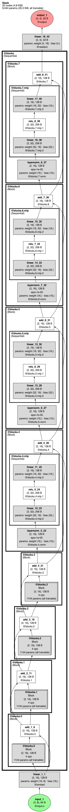](../images/visualization/collapse_quarter.png)

`trace.draw(collapse=0.25)`

[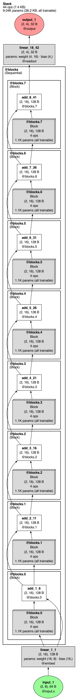](../images/visualization/collapse_half.png)

`trace.draw(collapse=0.5)`

[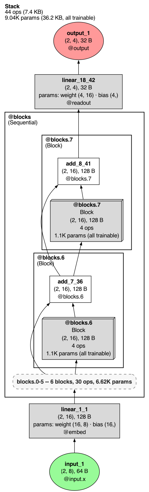](../images/visualization/collapse_max.png)

`trace.draw(collapse='max')`

A number picks a stop on a schedule of folding steps that runs from `0.0` (the same as
`"none"`) to `1.0` (the same as `"max"`); a larger number never shows more detail than a
smaller one. Equal steps in the number fold the graph by equal ratios: here `0.25` draws the
inside of the first four blocks as boxes and leaves 32 nodes, and `0.5` does so for all eight
and leaves 20. Each block's residual `add` stays visible beside its box. `"max"` condenses
everything that can be condensed: here the dashed rounded box stands for the first six blocks
in a row and says how many blocks, operations and parameters it holds. On other models such a
box stands for a run of operations and names its first and last operation, how many it holds
and the modules it spans. The schedule has only the steps the model allows, so on a small model
several numbers can give the same drawing; `trace.draw(...).collapse_schedule` lists the
steps.

`"auto"` picks the level for you, aiming at a graph of readable size. A small model is left as
it is; a large one is folded until it fits. Here it is on the same model with 40 blocks
(204 nodes uncollapsed):

[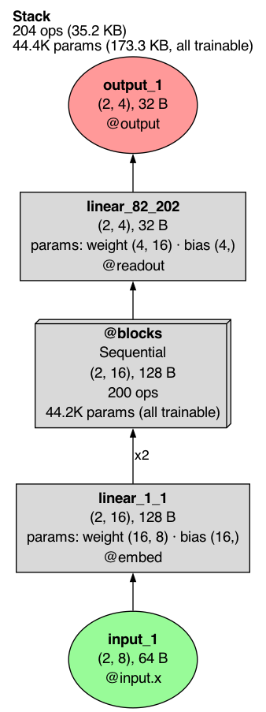](../images/visualization/collapse_auto.png)

`trace.draw(collapse='auto')`

`x2` on the arrow into `@blocks` means two separate arrows were merged into one: the
embedding output feeds both the first block's layer norm and its residual add, which are
both inside the box.

`fold_repeats=` controls whether runs of identical modules fold into one: `None` (the
default) leaves it to the collapse mode, `True` folds every repeated run it can, and `False`
never folds.

## Focusing on one module

`module=` draws only the inside of one module, given as its address or its `Module` record.
It focuses the forward graph only: `graph="backward"` and `graph="combined"` refuse it.

[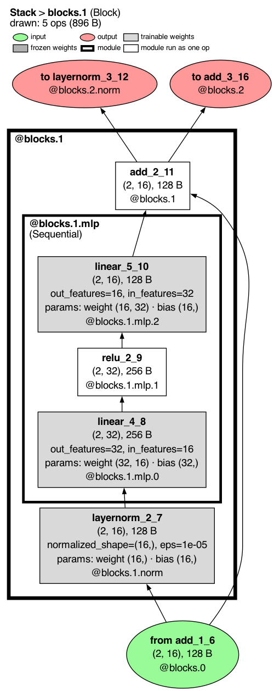](../images/visualization/module_focus.png)

`trace.draw(module='blocks.1')`

The header gives the path to the module (`Stack > blocks.1`, of class `Block`) and that
module's operation count and size. The operations outside the module that connect to it appear as stubs: green
`from` nodes feed the module and salmon `to` nodes read from it, each naming the operation and
module on the other side. The reading key at the top is on by default for a focused drawing.

## Ready-made views

`view=` picks a premade view: a bundle of draw settings plus a caption, each built to answer
one question.

| Call | Question it answers |
|---|---|
| `trace.draw(view="overview")` | what is this model? |
| `trace.draw(view="debug")` | what is broken? |
| `trace.draw(view="speed")` | where does time go? |
| `trace.draw(view="dims")` | what shape is the data? |
| `trace.draw(view="transformer")` | how is attention wired? |
| `trace.draw(view="memory")` | what is big in bytes? |
| `trace.draw(view="sequence")` | how do the passes unfold? |
| `trace.draw(view="compute")` | where are the FLOPs? |
| `trace.draw(view="interventions")` | what did the edits change? |

Each view prints any caption lines it needs under the header block (the header itself names
the model, the whole-network operation count and output size, and the parameters). Leaving `view=` unset draws the plain graph, which already shows
every operation. Any keyword you pass wins over the view's own settings, so combinations are
spelled with keywords, for example `trace.draw(view="debug", show_edge_shapes=True)`, and
`theme=` (see [Themes](#themes)) changes the colours of any view.

A view checks that the trace holds what it needs and refuses with a remedy when it does not:
`"speed"` needs timings, `"transformer"` needs attention modules and `"sequence"` needs more
than one pass. `"transformer"` draws the first repeated block that holds attention (for GPT-2,
`transformer.h.0`) and names it in the caption; pass `module=` to choose another.

### Profiling: `node_style="profiling"`

[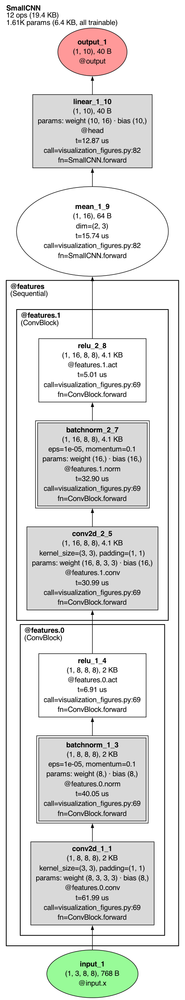](../images/visualization/profiling.png)

`trace.draw(node_style='profiling')`

Each node gains rows for how long the operation took (`t=`), the size of its output (`out=`),
the line of code that called it (`call=`) and the function that line is in (`fn=`).
`view="speed"`, `view="memory"` and `view="compute"` turn these rows on themselves and color
the nodes by time, bytes or FLOPs.

### What an edit changed: `view="interventions"`

After an edit (here, zeroing the output of `fc1` on a fork of the trace), the edited node is
marked in purple with the edit's name, and the header counts the edits in one line
(`1 edit: Δ zero_ablate on linear_1_1`); the capture facts stay on `edited.outcome`:

```text
edited = trace.fork()
edited.do(tl.module("fc1"), tl.zero_ablate())
```

[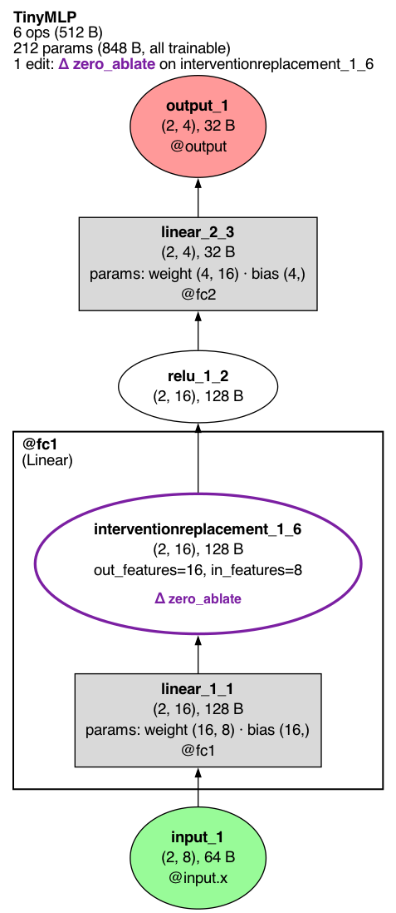](../images/visualization/edited.png)

`edited.draw()`

`show_cone=True` also shades, in translucent purple, every node and arrow downstream of an
edit: everything whose value the edit could have changed.

[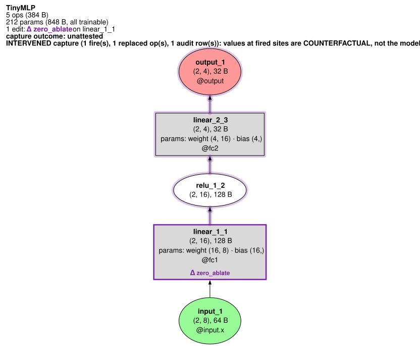](../images/visualization/show_cone.svg)

`edited.draw(show_cone=True)`

The shading is drawn into SVG directly; for PNG and PDF output it needs the optional
`cairosvg` package, and without it TorchLens warns and draws the edit marks alone.

`view="interventions"` shows what the edits changed. Each edited op gets a purple outline
(dashed when the site is inferred rather than recorded); every other op whose saved value
differs from the clean run gets a light purple outline and its largest absolute change; a
collapsed module box takes the marks of the ops inside it. The clean values come from the
unedited trace the fork came from, so keep it alive; when it is gone the caption says so and
only the edits are marked. The full record is written beside the image as `<path>.census.txt`,
and a trace with no recorded edit refuses with `surgery_evidence_missing`.

[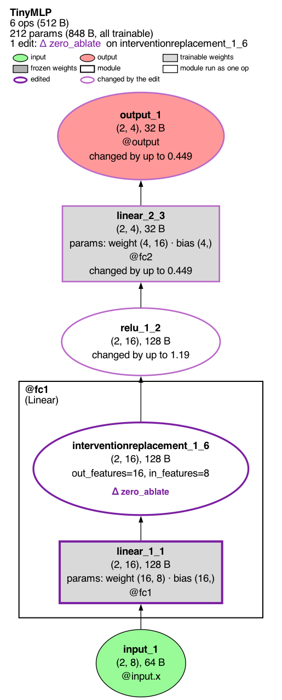](../images/visualization/interventions.png)

`edited.draw(view='interventions')`

## Color and size by any value

`color_by=` fills nodes from a color ramp by a value, and `size_by=` scales node area by a
value. Both take a built-in name (`"time"`, `"bytes"`, `"flops"`, `"magnitude"`,
`"grad_norm"`, and for `size_by` also `"dims"`), the name of a field on the node records, or
a function from a node to a number. The key shows a colour bar labelled with the quantity and
its units at both ends (`time: 0.098 ms ... 1.46 ms`) and, with `size_by`, one line such as
`size: output bytes, 15 KB ... 60 KB`, and nothing else. The colour scale is viridis, dark for
high values (slow, big) on a light page.

[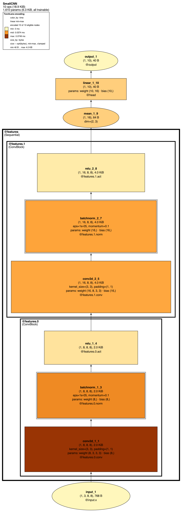](../images/visualization/color_size.png)

`trace.draw(color_by='time', size_by='bytes')`

Under `color_by=` the fill belongs to the scale, so the input and output keep their colours as
a ring instead: a pale green or salmon outline around the page fill, or around their own scale
colour when they carry a value. The key shows the same rings. `size_by=` alone changes no fill.

Nodes with no value for the source are left unfilled. `size_scale=` chooses how values map
to area. The smallest value draws at the drawing's typical node size and the largest at twice
that area, so a sized drawing stays close to its plain size; a node whose text needs more room
draws at what its text needs, at the normal font size.

## Direction

`direction=` sets which way the graph flows: `"bottomup"`, `"topdown"`, `"leftright"` or
`"rightleft"`. The default flows bottom up for the forward graph, top down for the backward
graph and left to right for the combined graph.

[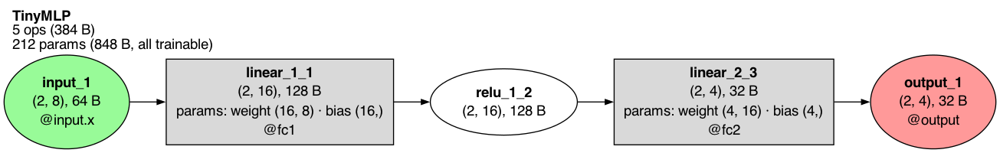](../images/visualization/leftright.png)

`trace.draw(direction='leftright')`

## Choosing what each node shows

`node_label_fields=` replaces the default rows with the ones you list, in order. The names
include `"name"`, `"type"`, `"shape"`, `"dtype"`, `"memory"`, `"module"`, `"params"`,
`"pass"`, `"flops"` and `"time"`.

[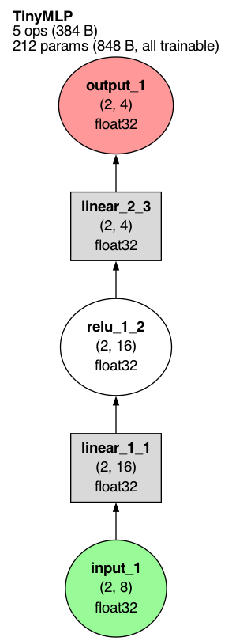](../images/visualization/label_fields.png)

`trace.draw(node_label_fields=['name', 'shape', 'dtype'])`

`show_saved_for_backward=True` adds a row on each operation that kept tensors for the
backward pass, with how many and how large; an operation that kept nothing gets no row.

[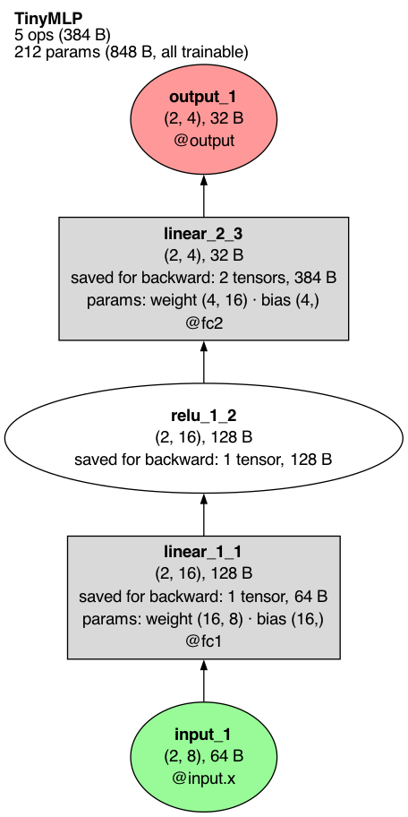](../images/visualization/saved_for_backward.png)

`trace.draw(show_saved_for_backward=True)`

`show_redundant_args=True` shows argument rows that TorchLens hides by default because the
node already implies them (for example `in_features` on a linear layer whose weight shape
says it).

## Buffers

Buffers are module state that is not a parameter, such as a batch norm's running mean and
variance. `show_buffers=` takes `"never"`, `"meaningful"` (the default) or `"always"`.

[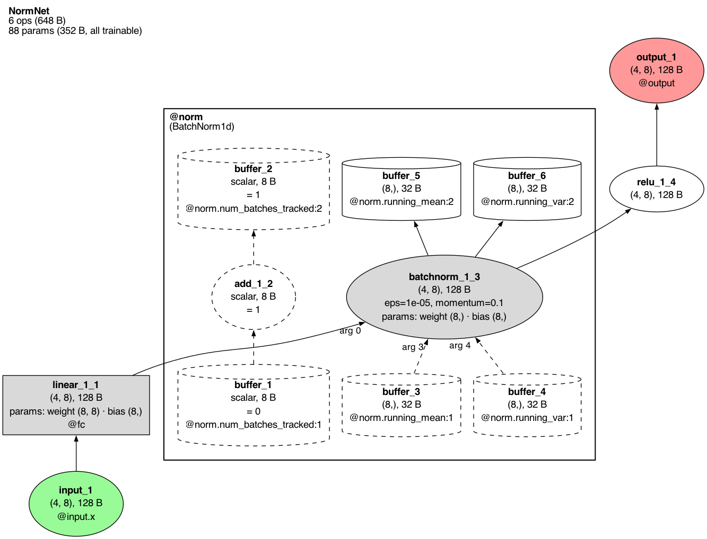](../images/visualization/buffers_always.png)

`trace.draw(show_buffers='always')`

Each cylinder is one version of a buffer: `@norm.running_mean:1` is the running mean as the
batch norm read it (dashed, with the argument position it fed, `arg 3`), and `:2` is the value
the batch norm wrote back in training mode. The dashed `add_1_2` is the batch norm adding one
to its `num_batches_tracked` counter. The default, `"meaningful"`,
leaves out buffers whose only role is routine bookkeeping like this; `"never"` hides all
buffers.

## The backward pass

After `trace.backward(loss)`, `graph="backward"` draws the gradient computation instead of
the forward pass, and `graph="combined"` draws both.

[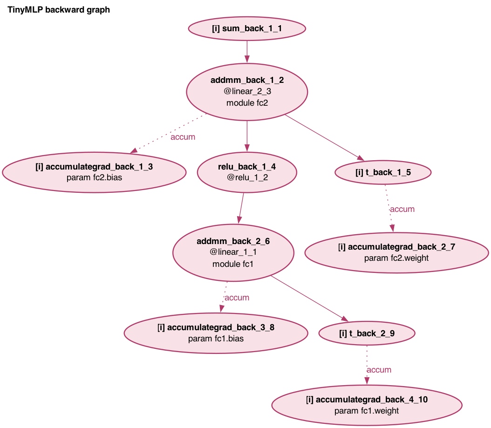](../images/visualization/backward_paths.png)

`trace.draw(graph='backward', show_module_paths=True)`

Each node is one autograd step (`grad_fn`). `@linear_2_3` names the forward operation the step
differentiates, and the `module fc2` and `param fc2.bias` rows come from
`show_module_paths=True`. `[i]` marks a step with no forward operation of its own, and a
`grad` row gives the shape of the gradient a step passed back when that gradient was saved
(gradients are saved per forward operation, so `[i]` steps have no `grad` row). A
dotted **accum** arrow is a gradient being accumulated into a parameter. `show_grad_values=True`
adds the norm and largest absolute value of each captured gradient. `show_legend=True` adds a
key for these marks. A drawing of two or more backward passes puts each pass in its own dashed
box, and each node names its pass (`bwd 2`).

## Themes

`theme=` restyles the whole drawing: `"torchlens"` (the default), `"paper"`, `"dark"`,
`"colorblind"` and `"high_contrast"`.

| `trace.draw(theme='paper')` | `trace.draw(theme='dark')` | `trace.draw(theme='high_contrast')` |
|---|---|---|
| [](../images/visualization/theme_paper.png) | [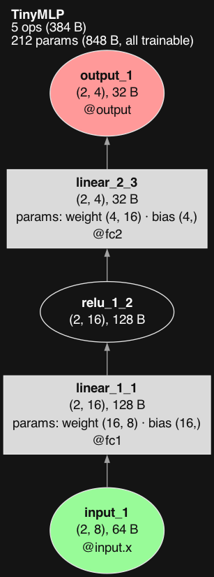](../images/visualization/theme_dark.png) | [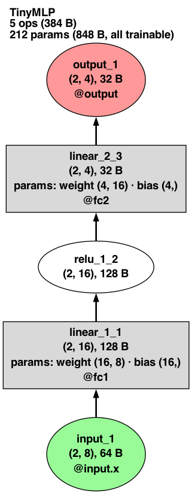](../images/visualization/theme_high_contrast.png) |

`"colorblind"` uses a palette that stays distinct under color-vision deficiencies; the default
palette does not (its frozen grey and input green, for example, can look alike):

[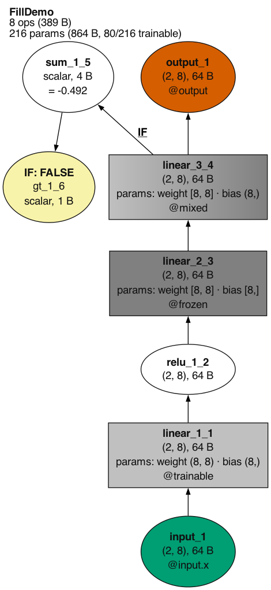](../images/visualization/theme_colorblind.png)

`trace.draw(theme='colorblind')`

## What a node can show

Beyond its label, a node can carry content of its own. `trace.annotate(selector, data=..., image=...)`
attaches your own data or an image file to the selected operations before drawing. `tl.viz.feature_maps`
renders a saved activation as an image grid. `tl.viz.nodes` holds the hooks (`node_spec_fn=`) that
restyle each node from its record, which is also how a plot of a layer's representation (an MDS
scatter, an RDM) ends up inside its node. Models TorchLens recognizes
(for example Hugging Face image classifiers) also label output nodes with their class names; see
[model conveniences](https://github.com/johnmarktaylor91/torchlens/blob/main/docs/guides/model_conveniences.md).

## Comparing runs

A `tl.Bundle` of traces draws as one picture with the same path and format rules as `Trace.draw`.
`bundle.draw(graph="diff")` draws the model once with each operation colored by how much its
output changed between the members (`metric="relative_l2"` by default, measured `on="out"`);
`members=` restricts the comparison to some of the traces. On a large model,
`bundle.draw(graph="diff", depth=2)` instead draws the compared member's own graph folded to that
depth, as `Trace.draw(depth=2)` folds it, with each module box colored by its most changed
operation. `graph="forward"`, `"backward"` and
`"combined"` draw the members' union graph for that pass, marking which members ran each node.
The [Compare runs tutorial](../../notebooks/learn/07_compare_runs.ipynb) walks through it, and the
glossary's `Bundle.draw` entry lists every keyword.

## Other options

These keywords of `Trace.draw` are not pictured above:

| Keyword | What it does |
|---|---|
| `path`, `file_format`, `dpi` | where to write the file, its format (default PDF) and resolution |
| `open_viewer` | open the written file in the system viewer |
| `layout` | node placement engine: `"auto"` (default), `"dot"` or `"rank"` |
| `code_panel` | add a panel of source locations (`True` or a panel spec) |
| `show_containers` | draw Python containers (lists, dicts) passed between operations: `"labels"`, `"collapsed"` or `"nodes"` |
| `show_orphans` | also draw operations whose output never reached the output |
| `order_siblings` | keep operations that run side by side in execution order (default `True`) |
| `font_size` | node font size |
| `stack_by`, `node_overlay` | stack repeated structure into columns; add an overlay row of scores to each node |
| `node_spec_fn`, `collapsed_node_spec_fn`, `backward_node_spec_fn` | a function that restyles each node |
| `graph_overrides`, `edge_overrides`, `grad_edge_overrides`, `module_overrides` | raw Graphviz attributes for the graph, forward edges, gradient edges and module boxes |
| `renderer` | `"graphviz"` (default) or a renderer registered out of tree |
| `fold_patterns` | fold named linear paths into one node: `"idiomatic"` for the curated conv-bn-relu preset, or a mapping such as `{"ConvBnRelu": "conv2d > batch_norm > relu"}`; not combined with automatic `collapse` |
| `collapse_fn`, `skip_fn` | your own predicates for which modules collapse and which operations are left out (see `tl.viz.nodes`) |
| `show_edge_shapes` | label each forward edge with the producer's output shape |
| `show_arg_labels` | label the edges into a multi-input operation (`cat`, a two-input function) with the argument position each parent fills (default `True`); `False` draws none |
| `show_input_transform_summary` | add a row summarizing the input preprocessing |
| `container_max_inline` | how many items a container shows inline under `show_containers="collapsed"` or `"nodes"` (default 12) |
| `intervention_mode` | how edited sites are marked: `"node_mark"` (default) or `"as_node"` |
| `bwd`, `intervening_cluster` | backward and combined graphs: which backward pass or passes to draw, and where backward-only nodes sit (`"upstream"`, `"outside"`, `"downstream"` or `"own"`) |

To put a picture on a node, annotate it before drawing: `trace.annotate(label, image=...)`
takes a path to any image file Pillow can open (PNG, JPEG, WebP, ...) or a PIL image. A PNG
file is drawn as it is; any other picture is drawn from a PNG copy, because some Graphviz
builds cannot read JPEG node images.

The [glossary](https://github.com/johnmarktaylor91/torchlens/blob/main/docs/reference/glossary.md)
lists every keyword with its accepted values.
