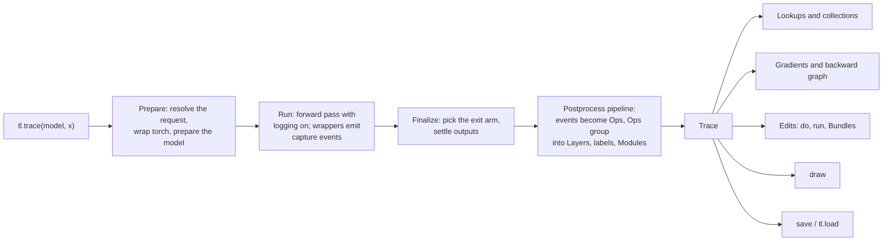
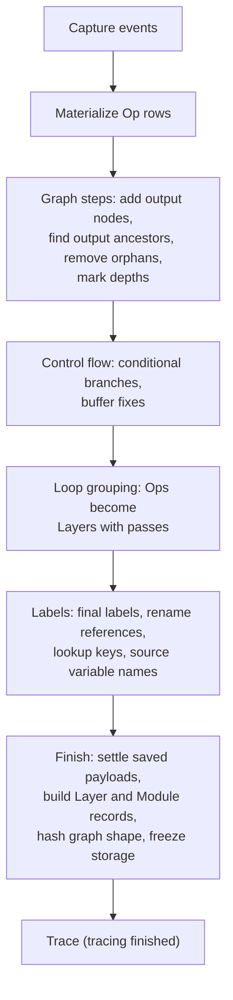

# How TorchLens works

This page explains what happens inside TorchLens between `tl.trace(model, x)` and the `Trace` you
read afterwards, and what the later operations (lookups, gradients, edits, drawing, saving) do with
it. It is written for someone who has run TorchLens at least once and wants a working model of the
internals, either to predict its behaviour or to start reading the code. Terms are used with the
meanings fixed in the [glossary](https://github.com/johnmarktaylor91/torchlens/blob/main/docs/reference/glossary.md). Contributors who need the module-by-module
map, package boundaries and the rules for changing them should continue with the
[maintainer architecture page](https://github.com/johnmarktaylor91/torchlens/blob/main/docs/maintainers/architecture.md).



## Wrapping torch, lazily

TorchLens sees a model by watching the functions it calls, not by reading its source. Every public
torch function (the `torch.*` namespace, `torch.nn.functional`, tensor methods and operators) is
replaced with a thin wrapper around the original. Nothing is wrapped when you import `torchlens`:
most of the package loads only when you first use one of its public names, and torch itself is
first wrapped at the start of the first capture. From then on the wrappers stay installed. When no
capture is running, a wrapper makes a handful of cheap flag checks (the module-level logging flag, plus flags
that stay off unless an opt-in feature is armed) and then calls the original function, so ordinary
torch code pays a small fixed cost per call. The
[plain-forward benchmark](https://github.com/johnmarktaylor91/torchlens/blob/main/docs/benchmarks/capture.md#a-plain-forward-after-a-trace)
measures that cost on real models.

Installation happens once per process. The first capture decorates every function TorchLens knows
about, registers the wrappers with the TorchScript builtin table so scripted code still resolves,
and sweeps for references to torch functions that were bound by name before the wrap. Later
captures only revalidate: they re-install the cached wrappers if something removed them and decorate
any custom operators registered since.

If you want torch left unwrapped after a capture, there are two ways to remove the wrappers again.
`tl.trace(model, x, capture=tl.options.CaptureOptions(unwrap_when_done=True))` restores the
original torch functions when that capture finishes. The context manager
`torchlens.backends.torch.wrappers.wrapped()` wraps torch on entry and unwraps it on exit, so
every capture inside one `with wrapped():` block shares one installation:

```python
import torch
import torchlens as tl
from torch import nn
from torchlens.backends.torch.wrappers import wrapped

model = nn.Sequential(nn.Linear(4, 4), nn.ReLU())
x = torch.randn(2, 4)

with wrapped():
    first = tl.trace(model, x)
    second = tl.trace(model, x)
# torch is unwrapped again here
```

The next capture after an unwrap wraps torch again and pays the revalidation described above. A
reference to a torch function taken while the wrappers are installed (`held = F.relu`) still points
at the wrapper after an unwrap; the
[detached-reference page](https://github.com/johnmarktaylor91/torchlens/blob/main/docs/migration/scoped_detached_patching.md)
covers that case and its remedies.

Watching function calls has one blind spot: code that reaches torch through a path the wrappers do
not cover. Two opt-in diagnostics check for that. The escape detector reports calls that bypassed a
wrapper, and the completeness witness counts low-level dispatcher events and checks that each one is
accounted for by a recorded operation. Their findings are reported in `trace.health`.

The model is handled differently from torch. The first time TorchLens sees a model instance it
records static metadata for each submodule (its address, such as `encoder.layer.0.attention`, and
its class) in a registry keyed by module identity, so nothing is stored on the module objects. The
`forward` wrappers on submodules, by contrast, exist only for the length of one capture: they are
installed when the capture starts and removed when it ends, so between captures the model carries
no TorchLens code and copies, pickles and saves as if TorchLens had never touched it. During the
forward pass those wrappers push and pop a module stack, so every operation knows which module
calls it is nested inside.

## What a capture records

When the flag is on, a wrapper does a fixed sequence of work around the real call. It snapshots the
arguments (recording which of them are tensors TorchLens has already seen), the random-number and
autocast state, and the time; it calls the original function; and then it decides which outputs to
log. An output is logged when it is a tensor (subclasses count, `nn.Parameter` does not) and either
it has no TorchLens label yet or the call is a bottom-level one, meaning it is not running inside
another wrapped call. That rule keeps composite functions from being recorded twice: when
`torch.nn.functional.linear` calls lower-level operations internally, only the outermost visible
call becomes an operation.

Each logged output tensor receives a raw label, stored in a small private metadata slot on the
tensor itself. Raw labels look like `cos_3_raw` and are only meaningful during the capture. When a
later operation receives that tensor as an argument, the wrapper reads the label back, which is how
TorchLens knows the dataflow edge between the two operations without ever inspecting Python
variables. In-place operations are handled explicitly so that the edited tensor's history stays
correct.

What leaves the wrapper is a capture event: the function, its parent labels, the argument
templates, the module stack, shapes and dtypes, timing, and the output tensor if the request asked
for it to be kept. Whether a payload is kept is decided during the forward pass by the `save=`
request; everything else is recorded for every operation.

## One forward pass, end to end

`tl.trace` resolves its keywords and hands the request to a dispatcher, which picks the backend
(torch unless you pass `backend=`) and calls that backend's capture entry point. For torch, a
capture runs in four stages.

1. **Prepare** turns the call into a resolved request: the `capture=`, `save=`, `intervene=`,
   `stop_after=` and `storage=` options are checked and normalized, and the `save=` request is
   resolved into the check each operation will meet during the forward pass.
2. **Wrap** makes sure torch and the model are instrumented, as described above.
3. **Run** seeds and snapshots random state, labels the inputs, and calls the model's forward with
   logging switched on. The forward ends in one of four ways: it completes; it is halted on purpose
   (`stop_after=` reached its target); it fails because the model raised; or it is interrupted.
4. **Finalize** handles each of those exits. A completed forward records the model's outputs and
   runs the postprocess pipeline. A failed forward raises `TraceCaptureError`, which carries the
   recoverable prefix as `exc.partial_trace`; a partial trace is never passed off as complete.

The postprocess pipeline is where the raw events become the objects you query. It is an ordered
list of named steps, each of which declares the fields it reads and writes, and the order matters:
later steps rely on facts that earlier steps established.



The first step materializes the events into operation rows. The graph steps add explicit output
nodes, find everything that feeds the outputs, drop orphans, and compute depths. The control-flow
steps mark conditional branches and tidy buffer bookkeeping. The grouping step decides which
operations are passes of the same layer. The labeling steps assign final labels, rewrite every
reference from raw to final labels, build the lookup keys, and attach source variable names. The
finishing steps settle deferred saves, build the Layer and Module records, hash the graph shape, mark tracing as finished, and release references that are no longer needed.

The operations themselves live in one columnar store owned by the trace. While the pipeline runs,
rows are mutable lists; when it finishes they freeze into per-field columns. An `Op` object is a
small facade holding the trace and a row index, so a trace with a million operations does not hold
a million full Python objects. The trace keeps a flag that says whether tracing is finished, and a
few behaviours (lookups among them) differ before and after it flips.

## Ops, Layers, Modules and passes

The three main record types answer different questions.

- An **Op** is one executed call: one wrapped function, one set of inputs, one output slot.
- A **Layer** groups the Ops that are the same piece of code run more than once. Each of those Ops
  is one pass of the Layer.
- A **Module** is one `nn.Module` instance; each time it is called you get a module call,
  addressed as `block:1`, `block:2`.

Grouping is structural. Two Ops belong to the same Layer when they share four things: the innermost
module instance that ran them, the call site (the Python frame chain inside that module's
`forward`), the operation name, and the output slot. A `for` loop that applies the same code three
times therefore yields one Layer with three passes, while the same three calls written out by hand
yield three Layers, because their call sites differ. The [grouping guide](https://github.com/johnmarktaylor91/torchlens/blob/main/docs/guides/grouping.md)
covers the rule and its edge cases.

Final labels follow from this. A Layer label has the form `{layer_type}_{type_num}_{total_num}`,
for example `relu_1_2`: the first `relu` Layer, and the second Layer in capture order counting
only operations (inputs, outputs and buffers are not counted). Inputs, outputs
and buffers use the shorter `{type}_{num}`. When a Layer has more than one pass, its Ops carry a
pass suffix, `relu_1_2:3`; passes are numbered from 1 in capture order. A single-pass Layer's Op has
no suffix, so the common case reads cleanly.

```python
import torch
import torchlens as tl
from torch import nn


class Looped(nn.Module):
    def forward(self, x):
        for _ in range(3):
            x = torch.tanh(x) * 0.5
        return x


trace = tl.trace(Looped(), torch.ones(2, 4))
tanh_layers = [layer for layer in trace.layers if layer.func_name == "tanh"]
assert len(tanh_layers) == 1
assert tanh_layers[0].num_passes == 3

torch.manual_seed(0)
model = nn.Sequential(nn.Linear(4, 8), nn.ReLU(), nn.Linear(8, 2)).eval()
x = torch.randn(3, 4)
saved = tl.trace(model, x)
edited = saved.fork("edited")
edited.do(tl.module("1"), tl.zero_ablate())
head_out = edited.find_sites(tl.module("2")).first().out
head_layer = model[2]
assert torch.equal(head_out, head_layer(torch.zeros(3, 8)))  # the head saw a zeroed ReLU output
```

## Lookups and the typed collections

There are two ways in. The typed collections each return one record type: `trace.layers`,
`trace.ops`, `trace.modules`, `trace.module_calls`, `trace.params` and `trace.buffers`. Each accepts
an index, a label or a slice, has filters such as `trace.layers.compute`, `trace.layers.recurrent`
or `trace.params.trainable`, and serves `.labels`, the tuple of its members' lookup labels. Use
these when you know what kind of thing you want.

The general door is `trace[...]`. It returns a Layer, an Op, a Selection, a Module, a module
call, a Param, a Buffer or a backward-graph node: the kind the key names. Integers and slices index the ordered
list of Ops. A string is tried in a fixed order: a module address is first rewritten to its
canonical form; then the string is looked up as a Layer label, which gives that Layer (single- or
multi-pass); then among the other lookup keys the labeling step built for every Op; then in each
typed collection in turn; then case-insensitively; and finally as a substring that must match
exactly one Op. If nothing matches it raises `KeyError` with a help message. Pass tokens work
wherever an Op label does: `relu_1_2:2` names one pass, `relu_1_2:last` the last, and
`relu_1_2:all` returns a Selection of every pass. A bare label of a multi-pass Layer gives the
aggregate Layer; a door that must give one Op refuses it instead of guessing a pass:
`trace[tl.label("relu_1_2")]` with the code `multipass_bare_label_ambiguous` and
`trace.ops["relu_1_2"]` with `ambiguous_op_lookup`.

The third form is a selector. `tl.module(...)`, `tl.func(...)`, `tl.label(...)`, `tl.in_module(...)`,
`tl.where(...)` and `tl.grad(...)` build a `tl.Selector`, a query that does not depend on any
particular trace. Selectors combine with `|`, `&`, `-` and `~`. Indexing a trace with one,
`trace[selector]`, resolves it against that trace and returns a `tl.Selection`, an ordered tuple of
`tl.types.Site` rows (a key, a mask and the provenance of the match). A Selection is tied to the
live session; save the selector, not the Selection. The same selectors drive `save=`, `intervene=`
and `trace.do`, so one spelling names a site everywhere.

## Saved activations, gradients and the backward graph

Activations are saved during the forward pass. When `save=` is a predicate or a label TorchLens can
recognise while the model runs, each matching Op's output is kept as it is produced. A few
selectors need the finalized labels to resolve; for those TorchLens records the forward, resolves
the selector during postprocess, and settles the payloads before tracing finishes. Either way, a
saved Op exposes its tensor as `op.out` and says so with `op.has_saved_activation`. Saved
activations stay connected to the autograd graph by default in `tl.trace`
(`detach_saved_activations=False`), so you can backpropagate through them. The glossary entry for
saved-activation autograd history lists which doors detach.

Gradients use the same machinery in the other direction. `CaptureOptions(save_grads=...)` names
the Ops whose gradients you want, and the capture installs tensor-level backward hooks on exactly
those outputs. You then run the backward pass through the trace, with `trace.backward(loss)` or
inside `with trace.capture_backward(): loss.backward()`, and each hooked Op fills in `op.grad`.

During the same backward pass TorchLens walks the autograd graph from the loss and records it: one
record per `grad_fn` node, one per call of that node, and one per backward pass. They are read
through `trace.autograd` (`trace.autograd.grad_fns`, `trace.autograd.backward_passes`), and the
backward graph can be drawn on its own or overlaid on the forward graph with
`trace.draw(graph="backward")` or `trace.draw(graph="combined")`. The live autograd graph exists
only in the session; a saved artifact keeps the records, not the graph.

## Interventions

An intervention is an edit to an intermediate value. The edit is a rule: a selector naming where,
and an edit saying what, such as `tl.zero_ablate()`, `tl.scale(0.5)` or your own function.
`tl.when(selector, edit)` builds a `tl.Recipe` holding such rules (`tl.intervention.Rule`). There
are three places to apply one.

- **During capture.** `tl.trace(model, x, intervene=recipe)` applies the edit as the forward runs;
  the trace records the edited run.
- **After capture, with `trace.do`.** `do` is the one editing verb. It stages the edit and then
  propagates it with one of three engines. Without `model=` and `inputs=`, the replay engine
  re-executes the saved graph: it computes the cone of Ops downstream of the edited sites, orders
  that cone by dependency, and calls each Op's recorded function again on its recorded arguments,
  substituting edited parents, pass by pass. The model's `forward` is never called. With both
  `model=` and `inputs=`, the rerun engine runs the whole model again with the edit armed as a
  hook, which is what edits on gradients need. `InterventionOptions(engine="set_only")` stages the
  edit without propagating it. `do` edits the trace in place and returns it; call `trace.fork()`
  first (a copy-on-write copy) to keep the original. `InterventionOptions(differentiable=True)`
  replays onto a new fork whose outputs stay differentiable.
- **Without a trace.** `recipe.bind(model)` returns a bound model that applies the rules as hooks
  on every call, with no capture at all.

`trace.run(...)` re-executes the model on the same or new inputs with the trace's current recipe
armed. It returns the refreshed trace, or a lighter result object on the explicit fast path
(`fast=True`). The trace keeps its edit history: `trace.recipe` holds the
active rules, `trace.clear_edits(...)` removes them, and `trace.state_history` records what
happened.

A `tl.Bundle` is a named collection of aligned traces, for example a clean run and several
edited forks of it. `tl.sweep` builds one by applying an edit across a range of values.
Bundles compare their members (`bundle.compare(...)`), draw them, apply an edit to
every member with `bundle.do(...)`, and index into all members at once with `bundle.at`.

## Drawing

`trace.draw()` turns a trace into a graph picture and returns a `tl.viz.Drawing`. The path is in
two parts. First the trace is projected into a render description that is independent of any
drawing library: nodes, edges, clusters for modules, and the options you passed (`graph=` for
forward, backward or combined; `rolled=True` to draw each multi-pass Layer once with a pass count
instead of unrolling every pass; `collapse=` to fold modules; `layout=` to choose the layout
engine). Then a renderer turns
that description into output. Renderers are looked up in a registry; Graphviz is the default. Edited
sites are marked on the drawing, and `trace.animate(site)` steps through passes.

## Saving, loading and validation

`trace.save(path)` writes a `.tlspec` directory: a `manifest.json` describing the contents, a
pickled metadata file, and safetensors files holding the saved tensors. The write goes to a temporary
directory first and is renamed into place when complete, so an interrupted save never leaves a
half-written artifact under the final name, and leftover temporary directories are cleaned up
later. `level=` controls what is kept. `"portable"` (the default) keeps the records with the saved
activations and gradients. `"audit"` keeps the records without tensor payloads. `"runnable"` is
also payload-free but keeps what is needed to execute the saved graph again, and requires a capture
made with `capture=CaptureOptions(replayable=True)`. `"executable_with_callables"` keeps the
payloads plus the saved arguments and random-number states needed to re-execute operations.

`tl.load(path)` reads the manifest first and checks it before it trusts the metadata file, and it
unpickles that file with an allowlist, so loading an artifact does not execute arbitrary code.
With `lazy=True` tensors are read from disk on first access. Depending on what was saved, `tl.load`
returns a `Trace`, a `tl.Bundle` or a `tl.Recipe`. Some facts exist only in a live session: a
loaded trace has no live model return value, and `trace.output` refuses with `output_not_stored`
rather than returning `None`.

Validation is how TorchLens checks itself. `tl.validate(model, x)` captures the model and then
checks the trace in three ways: the trace's outputs must match a fresh forward pass; every saved
operation, re-executed on its saved parents, must reproduce its saved output; and re-executing an
operation from a perturbed parent must change its output, which shows the previous check is not
passing trivially. `trace.check_metadata_invariants()` checks the internal
consistency of a trace's records. These checks are tripwires: a validation failure means TorchLens
recorded something wrong, and the fix belongs in the capture code, never in the check.

## Backends

Torch is the reference backend; the other five have fewer features than PyTorch (see the table in
[Backend Support](backends.md)). The capture machinery talks to a backend through a protocol
(`tl.backends.BackendProtocol`), and backends are registered with a spec saying whether they
execute eagerly or lazily. TensorFlow, JAX and Paddle are eager backends; MLX and tinygrad are
lazy backends, captured by realizing the computation once. You select one with
`tl.trace(..., backend=...)`. The non-PyTorch backends build their traces through a shared finalizer that reuses the torch pipeline's loop
grouping and module-record steps, so they produce the same `Trace`, `Layer` and `Op` types and the
same label and lookup rules. What each backend supports is listed in its scorecard. See
[Backends](https://github.com/johnmarktaylor91/torchlens/blob/main/docs/backends.md).

## The sparse path

`tl.record(model, x, save=...)` is a lighter capture for when you only need a few payloads. It
records a sparse event stream as a `Recording` instead of building the full trace during the
capture. `Recording.to_trace()` runs the same postprocess pipeline to produce a full `Trace` when
you need the graph. Reading a payload that `save=` did not select fails explicitly.

## Where to read the code

All paths are inside the `torchlens/` package.

| Part | Where |
| --- | --- |
| Public names and lazy imports | `__init__.py`; `_user_funcs.py` (`trace`, `draw`, `summary`) |
| Torch wrapping, module stack, model prep | `backends/torch/` (`wrappers.py`, `model_prep.py`, `module_stack.py`, `_tl.py` for tensor labels) |
| Capture stages | `_capture/` (`prepare/`, `run_entry.py`, `run.py`, `finalize/`, `stages.py`) |
| Capture events | `_ir/` (`capture_events.py`, `events.py`) |
| Postprocess pipeline | `_postprocess/` (`_pipeline.py` lists the steps in order; `_materialize.py`, `graph_traversal.py`, `control_flow.py`, `loop_detection.py`, `labeling.py`, `finalization.py`) |
| Trace, Op, Layer, Module records | `_data_classes/` (`trace.py`, `op.py`, `layer.py`, `interface.py` for `trace[...]`); `_trace_core/op_store.py` for the row store |
| Selectors and Selections | `_selection/` |
| Gradients and the backward graph | `backends/torch/backward.py` |
| Interventions | `intervention/` (`spec.py`, `_trace_edits.py` for `do`, `replay.py` and `_replay_cone.py` for the replay engine, `rerun.py`, `_trace_run.py`, `helpers.py`, `sweep.py`) |
| Bundles | `bundle/` |
| Drawing | `_visualization/` (`_trace_draw.py`, `render_ir.py`, `renderer_registry.py`, `renderers/`) |
| Saving and loading | `_io/` (`bundle.py`, `manifest.py`, `_safe_unpickle.py`) |
| Validation | `validation/` (`consolidated.py` for `tl.validate`, `core.py`, `invariants.py`) |
| Backends | `backends/registry.py`, `backends/_protocol.py`, one folder per backend under `backends/` |
| Sparse recording | `recording/`, `_capture/projections.py` |

## Further reading

- [Glossary](https://github.com/johnmarktaylor91/torchlens/blob/main/docs/reference/glossary.md): the meaning of every public term used here.
- [Grouping guide](https://github.com/johnmarktaylor91/torchlens/blob/main/docs/guides/grouping.md): how Ops become Layers, in detail.
- [Intervention API](https://github.com/johnmarktaylor91/torchlens/blob/main/docs/intervention_api.md): every editing door and its options.
- [Backward](https://github.com/johnmarktaylor91/torchlens/blob/main/docs/backward.md): gradients and the backward graph.
- [Maintainer architecture](https://github.com/johnmarktaylor91/torchlens/blob/main/docs/maintainers/architecture.md): package boundaries and rules for
  changing them.
