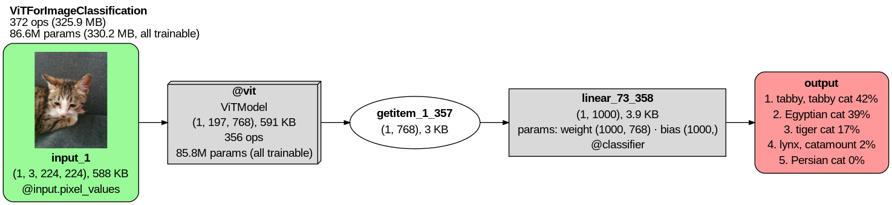
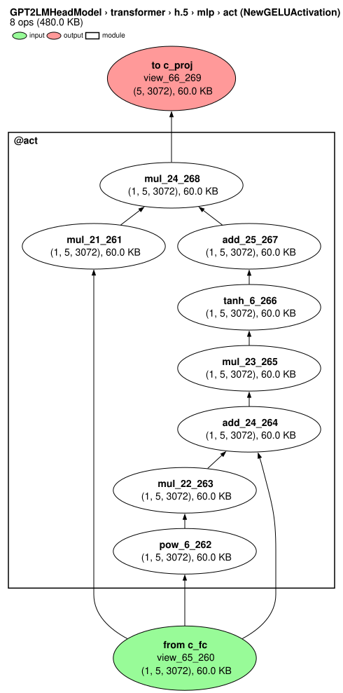

---
hide:
  - navigation
---

# TorchLens

**Inspect, visualize and intervene on any operation in any neural network.**



## Why?

Understanding and controlling the computations inside neural networks is [the most important scientific challenge of our time](https://darioamodei.com/post/the-urgency-of-interpretability) (at least). Progress on this problem, known as *mechanistic interpretability*, would [make AI more beneficial for society](https://www.goodfire.com/research/interpretability-for-alzheimers-detection), [illuminate how our brains work](https://doi.org/10.1146/annurev-vision-082114-035447), and guard against undesirable behaviors like [deception](https://arxiv.org/abs/2412.14093) or [killing us all](https://ai-2027.com/).

Some aspects of mechanistic interpretability are deep and open-ended. We need to understand dauntingly complex systems that may soon outsmart us, with new frontier models arriving faster than we can study the current ones. It's not even clear what a "solution" would look like, or how many obstacles remain. We'll surely need help from the AI agents themselves.

Other aspects are just plumbing, and while tedious, they are finite: the same small set of tasks for every model, like extracting and editing its activations and gradients. For instance, PyTorch has long lacked a built-in way to extract every intermediate activation from arbitrary networks (an official docstring admits this can take ["some massaging"](https://github.com/pytorch/vision/blob/e334535aaf10e3327b618e1f9f069e09d18ebb8e/torchvision/models/feature_extraction.py#L391-L405)). But all networks are built from the same basic parts, so a few well-made tools should work on all of them.

The modest goal of TorchLens is to fix these plumbing problems once and for all, so you and your agents can spend your time and tokens on the deep questions, and maybe even solve some of them.

## What TorchLens does

Almost everything you do in TorchLens starts with one function, `tl.trace`. You don't have to set anything up. Pass it any PyTorch model and its input exactly as they are, with no hooks, wrappers or changes to your code:

```python
import torchlens as tl
from transformers import GPT2LMHeadModel

gpt2 = GPT2LMHeadModel.from_pretrained("gpt2").eval()
text = "The capital of France is"

trace = tl.trace(gpt2, text)                  # run model as-is, logging every operation
op = trace["tanh_6"]                          # fetch the 6th tanh operation
op.out.shape                                  # torch.Size([1, 5, 3072])
op.parents, op.children                       # the operations before and after tanh_6
mlp = trace["transformer.h.5.mlp"]            # look up a module's record by its address
mlp.total_flops_forward                       # MLP's forward FLOPs (one of 800+ metadata fields in TorchLens)
trace.draw(module="transformer.h.5.mlp.act")  # draw the graph of the MLP's GELU activation module
```

{ width="400" }

This figure zooms in on the MLP's GELU module; here is [the whole GPT-2 graph](https://modelmenagerie.ai/models/gpt2-huggingface/). Each node is one tensor operation. For instance, `tanh_6_270` is the 6th `tanh` operation and the 270th operation overall. The function name and call number are enough on their own, so `trace["tanh_6"]` and `trace["tanh_6_270"]` return the same operation. A trace can also be indexed by a module's address (`trace["transformer.h.5.mlp"]`) or by a selector (below).

Since the trace holds everything, TorchLens doesn't need a separate tool for every question. A small "basis set" of composable tools covers just about anything you'd want to do when inspecting or intervening on a network:

- **Select** activations or gradients by any criteria, from simple ("every LayerNorm in the `transformer.h.5` module") to sophisticated ("every unit in `layer1` and `layer2` of a ResNet affected by a specific set of units in `conv1`").
- **Extract** activations at whatever speed or level of detail you need: save them all, stop the forward pass once you have the ones you want, or quickly run a dynamic model many times while saving only those matching your criteria (e.g., every ReLU after a convolution).
- **Inspect** every part of a network in exhaustive detail.
- **Visualize** a model's computational graph using one-line defaults, premade styles for common tasks (e.g., profiling, seeing what an intervention changed), or full customization. The [visualization guide](guides/visualization.md) explains every part of a drawing and every option.
- **Intervene** on any activation or gradient (using simple syntax based on Judea Pearl's [do-calculus](https://www.amazon.com/dp/1541608984)) to ablate, steer, patch in activations from another run (20+ built-in edits), or apply your own function.
- **Compare** any set of traces (e.g., clean vs. patched, different inputs, different checkpoints) operation by operation by grouping them into a `Bundle` object: compute metrics across them at any operation, find where they diverge most, and show the differences on the graph.
- **Debug** models with over 20 convenient functions for finicky tasks like locating the first operation that produces a NaN, finding dead units and exploding gradients, and inferring what input shape a model expects.

## Install

```bash
pip install torchlens                       # with pip

# Install Graphviz to draw a model's computational graph (https://graphviz.org/download/):
sudo apt install graphviz    # Debian/Ubuntu
brew install graphviz        # macOS
```

TorchLens runs on Python 3.10 to 3.13 with PyTorch 2.1 or later. Features that require other packages are optional extras; for example, `torchlens[hf]` allows you to pass raw text or images straight to Hugging Face and timm models, and `torchlens[tabular]` adds pandas for tables such as `output_table` (the full list is in [`pyproject.toml`](https://github.com/johnmarktaylor91/torchlens/blob/main/pyproject.toml)).

## Learning TorchLens

- **[Tutorial notebooks](https://github.com/johnmarktaylor91/torchlens/tree/main/notebooks/learn):** twelve short notebooks that build up TorchLens step by step, from a first trace to running full experiments at scale. Each runs on a laptop CPU in about a minute, or in your browser on Colab.
- **Guides by field:** where to start, depending on your work:
  - **[Mechanistic interpretability](https://github.com/johnmarktaylor91/torchlens/blob/main/docs/fields/mechanistic_interpretability.md)**
  - **[NeuroAI and computational neuroscience](https://github.com/johnmarktaylor91/torchlens/blob/main/docs/neuroai/journey.md)**
  - **[Debugging and training networks](https://github.com/johnmarktaylor91/torchlens/blob/main/docs/fields/debugging_and_training.md)**
  - **[Teaching neural networks](https://github.com/johnmarktaylor91/torchlens/blob/main/docs/fields/teaching.md)**
- **[Examples](https://github.com/johnmarktaylor91/torchlens/tree/main/examples):** runnable notebooks and scripts, from quick tasks to full experiments:
  - **[Recipes](https://github.com/johnmarktaylor91/torchlens/tree/main/examples/quick)**, one short self-contained notebook per common task: extract activations, find the operation that first produces a NaN, save and load a trace.
  - **[Workflows](https://github.com/johnmarktaylor91/torchlens/tree/main/examples/workflows)**: ablation grids, activation patching, steering, representational similarity for neuroscience.
  - **[Replications](https://github.com/johnmarktaylor91/torchlens/tree/main/examples/replications)**, scripts that re-test published interpretability findings on GPT-2: induction heads, the IOI name movers, causal tracing.
  - **[Recent methods](https://github.com/johnmarktaylor91/torchlens/tree/main/examples/methods)**, run end to end: the [Jacobian lens](https://github.com/johnmarktaylor91/torchlens/blob/main/examples/methods/jacobian_lens_recipe.ipynb), EAP-IG circuit discovery on GPT-2's IOI task, attribution graphs with transcoders, the logit lens on ViT and CLIP, LEACE concept erasure, DAS causal bases.
- **[Glossary](https://github.com/johnmarktaylor91/torchlens/blob/main/docs/reference/glossary.md):** definitions for every public function and argument.
- **[Stable API](reference/stable_api.md):** the names that keep their spelling and meaning across 3.x releases, and what is preview.
- **[API map](https://johnmarktaylor91.github.io/torchlens/api-map/):** an interactive, searchable map of every public module, class, function, method and argument, rebuilt from the code at each release.
- **[FAQ](faq.md):** common questions, including what TorchLens deliberately leaves to other tools.
- **[Also in TorchLens](https://github.com/johnmarktaylor91/torchlens/blob/main/docs/also_in_torchlens.md)**

## Where to start, by community

- [Mechanistic interpretability](https://github.com/johnmarktaylor91/torchlens/blob/main/docs/doors/mechinterp.md)
- [NeuroAI](https://github.com/johnmarktaylor91/torchlens/blob/main/docs/doors/neuroai.md)
- [Vision and dynamic models](https://github.com/johnmarktaylor91/torchlens/blob/main/docs/doors/vision.md)
- [Agent builders](https://github.com/johnmarktaylor91/torchlens/blob/main/docs/doors/agents.md)
